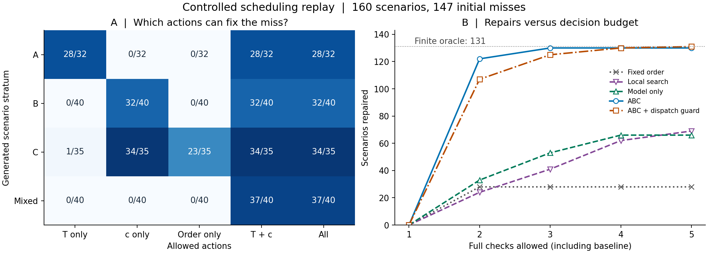
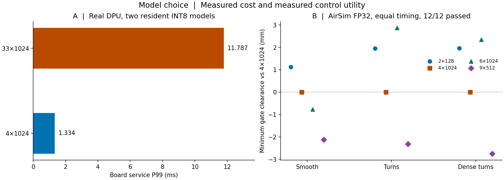
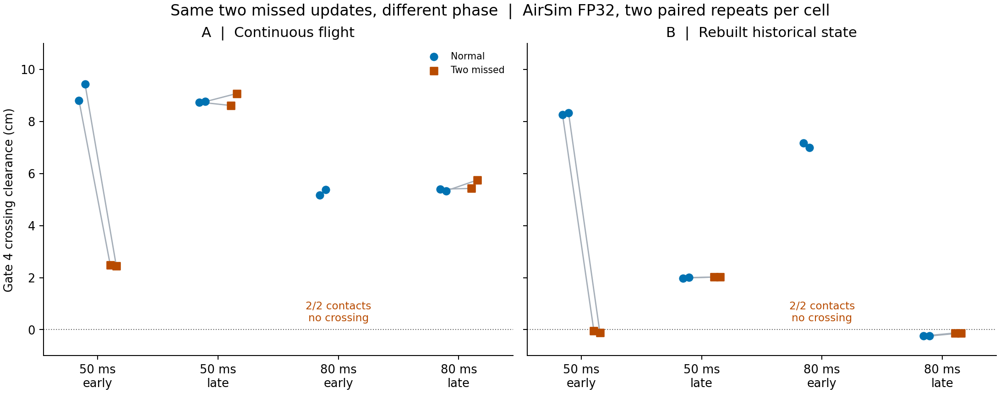
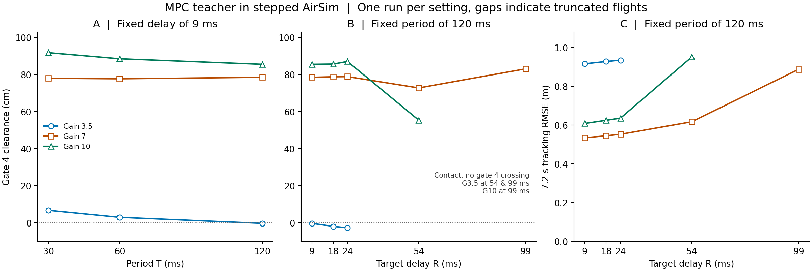

# 路线 B 组会讲稿｜多架无人机共享一块 DPU 时，怎么把关键命令及时送到

## 1. 先用一个飞行例子讲清楚问题

假设有六架无人机一起飞。大部分正在走直线，其中一架刚进入弯道，需要根据最新位置和速度算出一条纠偏命令。六架飞机共用一块 DPU，它们的推理请求可能同时到达。即使这个控制器算出的动作是对的，命令如果来得太晚，飞机也已经多沿着旧动作飞了一段。

一条控制命令经历以下过程。

~~~text
到计划时刻，发布控制任务
          ↓
采样飞机状态，构造 237D 输入
          ↓
等待共享 DPU，运行 DNN
          ↓
下发新的推力和角速度命令
          ↓
飞机开始按新命令运动
~~~

在这个过程中，路线 B 有三个可以调的量。

| 量 | 通俗意思 | 调它有什么用 |
| --- | --- | --- |
| **周期 \(T\)** | 同一架飞机隔多久发布一次控制任务 | 周期缩短，下一次采样可以来得更早，但后续任务也会变多 |
| **模型档位 \(c\)** | 这一条任务用哪个 DNN | 小模型可能算得快，前提是它在这类飞行状态下确实够用 |
| **派发策略 \(\sigma\)** | DPU 空闲时先让谁跑 | 调顺序能改变等待时间。已经在当前 DPU 上启动的任务要等它跑完 |

**周期和响应时间是两件事。** 如果规定每 50 ms 发布一次，任务可以在 0、50、100 ms 到点发布。若三条命令分别花了 8、20、8 ms 才送到飞机，那么命令到达时刻是 8、70、108 ms，相邻间隔是 62 和 38 ms。若中间有任务被丢弃，空窗还会更长。因此实验既要看发布周期，也要看命令什么时候送到。

**什么时候算晚。** 一条任务有自己的周期期限。同时，框架根据飞机当前状态和正在执行的旧命令，估计还能等多久才需要下一条控制。两个期限取更早的一个。例如任务按周期允许 50 ms 内完成，但弯道局部只允许再等 30 ms，调度就按 30 ms 处理。这里的 30 ms 是示意，当前飞行原型使用的是经验安全估计。

**路线 B 的思路**是先查哪一步使任务来不及，再选择对应的动作，最后检查这一改动会不会让其他飞机超期。下面先用三个小例子把这个过程讲明白。

## 2. 三种迟到是怎么区分的

三个例子都来自已运行的调度回放。这里暂时去掉主机输入准备等阶段，只保留影响结论的环节。小模型约用 1.334 ms，大模型约用 11.787 ms，数值来自 Zynq 双模型常驻时测得的板端服务 P99。下面的释放时刻和期限是为检验机制设置的。

### A．任务发布太晚，即使独占 DPU 也来不及

**怎么做。** 只放一架飞机，期限是 35 ms。原来在 34.5 ms 发布，已经用小模型。假设它一发布就立刻推理，也要等到 \(34.5+1.334=35.834\) ms 才完成，晚了约 0.83 ms。DPU 前面没有别的飞机，调优先级无从下手。

**改了什么，结果怎样。** 模型和派发规则保持相同。把周期从 60 改到 50 ms 后，下一条任务提前 10 ms，在 24.5 ms 发布。它约在 25.834 ms 完成，离同一个 35 ms 期限还剩 **9.17 ms**。

**这个例子给出的规则。** 先用“期限减去独占情况下的耗时”算出**最晚启动时刻**。如果下一次发布还可以改，就选能赶上的、尽量接近原配置的周期。若问题是路径太长，也可以试合格的快模型。若连当前立刻发布、走最快合格路径都晚了，这一条就已经错过补救时机。

A 讨论的是**能不能把当前关键更新提前**。它不要求整趟飞行都提高频率。平稳阶段把周期拉长，还可以减少后续到达的工作。

### B．任务都及时发布，但窗口里装不下这么多计算

**怎么做。** 两条任务在 0 ms 同时发布，都要在 20 ms 前完成，原先都用大模型。一块串行 DPU 总共需要 \(2\times11.787=23.575\) ms。无论先跑谁，第二条都迟到约 3.57 ms。

**改了什么，结果怎样。** 发布时刻不变，仍按原顺序执行，只把一条任务换成允许使用的小模型。总耗时变成 \(11.787+1.334=13.121\) ms，最后一条离期限还剩 **6.88 ms**。

**这个例子给出的规则。** 先找哪个时间窗、哪种资源装不下。分别算 PS 一侧的输入准备、派发等资源需求和 PL 一侧的加速器需求。接下来优先改那些**能在这个窗口结束前省下最多瓶颈资源**的任务。例如 DPU 忙时，试把合格回路换成更轻的模型；如果堵在主机采样或工作槽，单独缩小 DNN 可能没用。把其他飞机的周期拉长，只有当它确实减少了这个窗口里的工作，才能帮到当前急需更新的飞机。已经发布的任务仍按原义务计入。

还要分清两件事。**小模型算得快**可以用板端计时验证。**小模型够不够用**要靠相同飞行条件下的闭环实验验证。后面图 2 专门讲这部分。

### C．算力够，但先启动的长任务挡住了紧急任务

**怎么做。** 长任务在 0 ms 就绪，算 11.787 ms，期限是 25 ms。短任务到 2 ms 才就绪，只算 1.334 ms，但它的期限是 6 ms。如果 0 ms 立刻开始长任务，DPU 无法半途停下。短任务只能等到 11.787 ms 后才开始，约 13.121 ms 完成，晚了 7.12 ms。即使采用普通 EDF，也可能碰到这个情况，因为 0 ms 时短任务还没有就绪。

**改了什么，结果怎样。** 周期和模型都不改。如果系统已经知道短任务很快就绪，就先暂缓启动长任务。2 ms 开始短任务，它在 3.334 ms 完成，提前 **2.67 ms**。接着跑长任务，约 15.121 ms 完成，离自己的期限仍有 **9.88 ms**。两条都赶上了。

**这个例子给出的规则。** 在决定是否启动长任务前，比较紧急任务的两种预计完成时刻。若现在启动长任务会让它迟到，而短暂等待能让它按时，就试一次暂缓派发。然后重查整组，因为被暂缓的长任务也可能有自己的期限。这条规则只控制**尚未启动的任务**。当前板端使用整任务执行，段级抢占和保存／恢复是未来硬件分支。

[三种机制的原始对拍](../../local/controller_architecture_study/results/route_b_action_replay_20261109_v1/sanity.json) · [决策器说明](Route-B的ABC决策策略_20261106.md)

## 3. 把三个例子扩大成 160 个场景，分类还有用吗

### 怎么做

三个例子刻意把原因分开，只能说明机制存在。所以我们又生成了 160 个三回路场景，分为 A、B、C、Mixed 四层，每层 40 个。变化项包括发布时间、期限、初始阻塞、主机处理时间和各任务是否允许使用小模型。**两档模型耗时来自真板，其余条件是回放输入。** 每个场景先用原配置和整任务 EDF 跑一次，再对同一个场景只开放某种调整，检查全部任务是否都能按期完成。

例如只开放 \(T\) 的那列，可以调整周期但不能换模型或派发规则。最后还离线枚举了试验中允许的所有组合。这个枚举结果叫 **有限 Oracle**，用于统计在这组候选里到底有多少场景能修好。在线启发式只允许少量检查，无需完成这次枚举。

### 结果和读图方法

**先看左半张图。这里统计的是调度回放的时序结果。** 每行是一类构造场景，每列是允许改的变量。

- **原配置时序失败**指回放窗口内至少一条命令超过期限，或同一架飞机的上一任务到下一次释放时还占着工作槽。
- **时序修复**指只使用该列允许的动作，至少能找到一套配置，让窗口内所有命令按期、同机工作槽不重叠。一架飞机按期、另一架飞机被拖到超期，整组仍算失败。这里没有模拟飞机运动，因此不计撞门。
- **允许 \(T+c\)** 表示可以只改周期、只换模型或两者都改，派发策略保持原样。只有前面三种单项均找不到解的 Mixed 行中，才可以说这 37 例需要联合修改。

| 场景层 | 原配置时序失败数 | 只调 \(T\) 可修复 | 只换 \(c\) 可修复 | 只改派发可修复 | 允许 \(T+c\) 可修复 |
| --- | ---: | ---: | ---: | ---: | ---: |
| A | 32 | **28** | 0 | 0 | 28 |
| B | 40 | 0 | **32** | 0 | 32 |
| C | 35 | 1 | 34 | **23** | 34 |
| Mixed | 40 | 0 | 0 | 0 | **37** |

**为什么连枚举也有修不了的。** 检查一个给定配置能不能按期，是算完成时间；能否修复，还要看允许的动作里是否存在合格配置。147 例失败中，允许试验中的全部动作并枚举后仍有 16 例找不到解。比如 B 层的 73060 号场景，两条任务的当前释放已锁定，模型候选也只有大模型。DPU 窗口约 16.71 ms，两条任务的必做推理合计约 23.57 ms，缺 6.86 ms。重排可以改变谁先完成，但两条都按期需要更多容量或更少工作。有限枚举的范围包括指定周期、合格模型和三种派发规则。超过这个范围的方案没有纳入本次结论。[逐场景输入和枚举结果](../../local/controller_architecture_study/results/route_b_action_replay_20261109_v1/cases.json)

这里有两个容易误读的地方。第一，C 行换模型也能修好很多，因为把长任务变短同样可以减少它挡路的时间。C 类先试调度的价值，是有些任务可以保留原模型。两种 ABC 在 C 层都修好 34 例，加入派发保护后，累计模型改动从 **34 降到 11**。第二，A／B／C 行名来自场景生成方式。实际诊断按当前条件计算，B 层中也有被诊断为 A 或 C 的样本。

**再看右半张图。** 横轴是允许做几次全组检查，第一次用来检查原配置。纵轴是能修好多少场景。147 个原配置失败场景中，有限 Oracle 找到 131 个可以修。最多五次检查时，固定顺序修好 28 个、无诊断的局部搜索修好 69 个、原版 ABC 修好 130 个、加入派发保护后修好 131 个。原版和保护版平均用了 1.96 和 2.13 次检查。按实际入口的 3 ms 决策预算再筛，保护版是 **130/131**，因为有一例决策花了约 3.13 ms。

**这组实验能说明什么。** 按原因优先尝试相应动作，比固定尝试顺序更容易在有限检查次数内找到解。也有反例。另一个更重的 12 回路批次，把实测决策耗时算进去后，整任务 ABC 只通过 **23/160**，只换模型则通过 **40/160**。真实第 4 门附近的 59 条历史快照中，连有限 Oracle 也没找到可行配置，33 条在决策时已经有首个任务义务过期。当前首先要解决的是发现和执行是否来得及。

[160 场景与算法对照](Route-B动作回放_20261109.md) · [12 回路实验](Route-B的ABC决策策略_20261106.md) · [59 条历史快照](../../local/controller_architecture_study/results/route_b_action_gate4_20261109_v1/trace_summary.json)

## 4. 为什么测不同的 DNN，测完又为什么没直接上线切换

这里是两个实验，各自回答一个问题。

1. **真板计时。** 把两个 INT8 模型同时装在板端，让同一个模型连续跑，再让两模型交替跑。4×1024 与 33×1024 在交替组的服务 P99 分别是 **1.334 ms、11.787 ms**，单次服务差约 10.45 ms。对同一目标模型做配对，交替运行相对连续运行的服务耗时差 P99 约 **11 μs**。模型大小造成的运行时间差，与两个模型已常驻时交替调用的额外变化，是不同的测量。
2. **AirSim 等时延闭环。** 换成四个 FP32 模型（2×128、4×1024、6×1024、9×512），用相同的周期 50 ms、目标延迟 20 ms，分别飞平缓、连续反向转弯、门加密三条路线。四个模型飞三条路线，共 12 次，全部有效过门且零碰撞。两条较难路线的最小过门净空约 29 cm，四个模型之间只差约 **5 mm**。终点制动的恢复判据均未通过，所以这里说的是过门成功。

**怎么看图。** 左边是板端毫秒，右边是 AirSim 净空相对于 4×1024 的毫米差。两边来自不同实验，模型组合也不同。更难的局部初态中，横向速度偏差设为 1.45 m/s，三个模型碰撞，9×512 虽无接触但没满足有效过门净空。18 模型离线筛选也没有找到这个初态的合格模式。

因此，B 类已经有可利用的计算成本差。什么状态可降档、哪些状态值得用更大模型，仍要拿闭环数据单独确定。即使更大模型更像教师，也不能据此判断它飞得更好。

[真板双模型成本](Route-B板端配对实验_20261106.md) · [四模型飞行与 18 模型筛选](Route-B的Main18模型池启发式策略_20261109.md) · [18 模型原筛选图](../../local/controller_architecture_study/results/main18_pool_figures_20261109_v1/main18_recovery_heatmap.png)

## 5. 为什么同样漏两条控制，有时没事，有时撞门

### 怎么做

最初我们只把转弯临近门框时的两条命令由约 20 ms 延到约 40 ms。18 次 AirSim 都没碰撞，转弯门的净空只变化几毫米。后来改成**同一条路线、同一个 4×1024 FP32 模型，比较两个不同飞行阶段**。

- 早期和晚期分别取第 4 门参考过门时刻前约 **0.94 s** 和 **0.15 s**。
- 在各自阶段，都有一组正常发命令，另一组故意跳过连续两条。跳过期间飞机保持上一条控制。两组干预前的状态和时间经过配对检查。
- 一批从已有飞行记录的状态重建后开始，另一批从路线起点连续飞入，中途没有重置状态。合计 **32 次飞行、16 组有效配对**。

### 结果和读图方法

左半张是从起点连续飞入，右半张是重建历史状态。蓝点是正常更新，橙点是漏两条后的净空。没有橙点但标注碰撞的情况，是撞门后没有穿过门平面，因此无法测该次穿门净空。

- **50 ms 周期，从起点连续飞入。** 早期正常组穿门净空约 **8.8–9.4 cm**，漏两条变成 **2.4–2.5 cm**。晚期漏两条只变化几毫米。该批两种处理均通过。
- **80 ms 周期，合计两批。** 早期漏两条的 **4 次都撞第 4 门左框**，早期正常的 4 次都没撞，晚期均未接触门框。正常首条新命令在目标释放后约 18–21 ms 发出，漏两条后，50 ms 周期组约等 118–121 ms，80 ms 周期组约等 179–180 ms。因此两种周期下“漏两条”的实际空窗长度不同。

**为什么早期更容易出问题。** 在这条路线，早期正常命令相对旧命令的角速度变化约 **0.42–0.82 rad/s**，晚期约 **0.17–0.43 rad/s**。这说明早期本来就要做较大的动作更新。漏掉它，飞机会继续执行已经不适合下一段转弯的旧动作。这是对本路线的解释。别的弯道在哪个阶段敏感，需要用同样方法确认。

**和启发式有什么关系。** 现在知道有些任务错过以后代价较大。接下来要在这类阶段到来前计算期限，并辨别是发布太晚、输入没准备好，还是 DPU 排队。如果关键任务根本没进 DPU 队列，改 DPU 顺序救不了它。

[短延迟对照](Route-B局部延迟探查_20261109.md) · [早晚漏更新及历史相位扫描](Route-B的IP37命令空窗分析_20261109.md) · [离线相位图](../../local/controller_architecture_study/results/ip37_held_gap_replay_20261109_v3/phase_sensitivity.png)

## 6. 为什么再做增益 3.5、7、10 的实验

前面用的是已训练的 DNN。但如果一个控制器本身纠偏慢，缩短周期也未必足够；换一个控制器以后，可能又因为净空充裕而看不出周期差异。为了把这两件事分开，我们直接用**同一个 CPU MPC 教师**控制 AirSim，无需为三个增益先各训一套 DNN。姿态增益可以理解为，对同样的姿态偏差，教师要求飞机以多大的角速度去纠正。平动 QP、路线、初态与角速度限幅相同。

### 怎么做

选已有的 3.0 m 门宽路线，观察前 7.2 秒。每个增益分别组合 \(T=30,60,120\) ms 和 \(R=9,18,24\) ms，共 27 组。再对三个增益都固定 \(T=120\) ms，增加 \(R=54,99\) ms，共 6 组。每个条件跑一次。AirSim 在 MPC 求解时暂停，在模拟时钟走到预定时刻才发送命令，所以这里的 \(R\) 是施加给闭环的命令延迟，Windows 或板端的真实推理时间另算。三条发生碰撞的轨迹在碰撞前也都满足设定时序的容差。

### 结果和读图方法

左图固定约 9 ms 延迟看周期，中间固定 120 ms 周期看延迟。右图看前 7.2 秒的平均跟踪误差，提前碰撞的轨迹没有完整窗口，留空。

| MPC 增益 | 固定 \(R\approx9\) ms，周期 30／60／120 ms 的第 4 门净空 | 固定 \(T=120\) ms，长延迟时的结果 | 物理判据通过／实际碰撞 |
| --- | --- | --- | --- |
| 3.5 | +6.7／+3.0／−0.3 cm | \(R=54,99\) ms 都撞第 4 门左框 | 6/11，通过组之外有 2 次碰撞 |
| 7 | +78.0／+77.7／+78.5 cm | \(R=99\) ms 仍通过，RMSE 从低延迟约 0.53 m 增到 0.89 m | 11/11，零碰撞 |
| 10 | +91.8／+88.5／+85.5 cm | \(R=54\) ms 的 RMSE 已约 0.95 m，99 ms 撞第 3 门下框 | 10/11，1 次碰撞 |

**负净空和实际碰撞要分开。** 3.5 增益的 \(T=120,R=9\) 组净空略为负，表示机身没有满足我们预设的净空判据，AirSim 没有报告接触。这个组的全程平均跟踪误差还比 \(T=30,R=9\) 略小，说明平均误差可以盖住关键门的变化。

**怎么用这个发现。** 3.5 增益的教师已经表现出周期和延迟敏感性，因此先用现有 3.5 板端 DNN 在同一路线复核这些对照。增益 7 在这条路线净空充足，但单次矩阵不足以决定换教师。若现有 DNN 连及时交付时都很难稳定完成，而增益 7 的教师在独立路线也能稳定完成，再用增益 7 重标注并微调一版 4×1024。增益 10 在短周期、低延迟下净空更大，长延迟时限幅显著增多，在 99 ms 组碰撞前约 69.7% 的查询触发角速度限幅。99 ms 用于压力对照，部署选型主要看实际链路延迟范围。

[实验设置与离线预演](教师增益与时序网格_20261110.md) · [33 组 AirSim 实测表](../../local/controller_architecture_study/results/teacher_gain_timing_airsim_20261110_131546/summary.csv)

## 7. 目前真板做到了什么，最后还缺哪一个实验

**已经接通并飞过。** Windows 上的 C++ 日历与采样、Python 决策和命令下发、Zynq DPU 的 237D INT8 推理已经串起来。实际闭环用固定 ID 11。在线可以调整下一条任务的周期，已做过整任务 FIFO／EDF 对照。在线模型切换和 C 类派发保护仍属于回放验证，板端没有段级抢占。

**三机实飞做了什么。** 固定 50 ms 和动态周期都飞完了 15 个门，零碰撞。动态组 5 次整组安装，对应 7 次单机周期变化，记录到的请求从 1199 减到 774，平均位置 MSE 增加约 1.19%。但后来固定 80 ms 也能完成，所以这个实验说明在线调周期确实能生效、降低请求量。与公平优化的静态配置相比是否更好，还没有得到证明。

公平的静态对照可以给不同飞机选不同配置，但在出发前就确定各机的周期、模型和调度规则。动态组从同一套配置出发，飞行中再按状态修改。两组共用模型池、硬件和任务。这才回答“同样的资源下，在线调整能不能处理离线配置顾不到的局部危险”。

**六机实验为什么还没证明“救回”。** 审计旧飞行时，长空窗里的漏更新有 **92.5%** 未到板端队列。我们发现一种具体情况：上一条控制已经下发并收到确认，但负责该机的工作槽还在等待额外的状态回读，下一条任务来了却进不去。于是用固定周期做八次六机对照，比较 FIFO、EDF 和不同的回读时机。把额外回读统一延到下一次采样的两轮，前 10 秒都没有违规，但全程仍有违规。四种策略的 16 条目标更新全部按期，所以没有哪一条原本会迟到、改策略后被救回的关键命令。

**组会收尾可以这样讲。** “目前有两条独立证据。一条说明为什么迟到决定了应该调周期、模型还是顺序。另一条说明迟到发生在某些阶段，确实会影响能否过门。下一轮要用同一条路线、同样的负载和同一块 DPU，让这两条证据接起来。选出一条基线确实会漏掉的关键更新，看启发式能否按期交付，同时检查其他飞机有没有被拖慢。”

[真板执行链](../../../controller_architecture_study/docs/Route-B代码导览_20261109.md) · [三机固定／动态](IP37联合控制首轮结果_20261107.md) · [批量运行中的问题](IP37批量实验发现与研究调整_20261108.md) · [六机同条件对照](Route-B关键任务准入_20261109.md)

## 8. 老师问公式时可以翻这一页

### 统一时间和余量

设 \(r_i\) 是发布时刻，\(a_i\) 是命令生效时刻，\(R_i=a_i-r_i\)。在 \(t_i^{\rm obs}\) 观测到当前状态后，以当前已生效命令为条件估计还能保持 \(B_i\) 多久。将物理期限与任务自己的周期期限取较早者。用 \(\widehat a_i\) 表示候选配置预测的命令到达时刻。

$$
d_i^{\rm safe}=t_i^{\rm obs}+B_i,\qquad
d_i=\min(d_i^{\rm safe},r_i+T_i),\qquad
S_i=d_i-\widehat a_i.
$$

\(S_i>0\) 表示预计还有时间，\(S_i<0\) 表示预计超期。固定周期且没有漏发时，相邻命令的生效间隔是 \(T_i+R_{i,k+1}-R_{i,k}\)。在线日志用命令确认时间近似生效时刻。

### A 的公式

\(L_i^{\rm solo}(c)\) 是不排队时走完整链路的耗时，\(t_{\rm ready}\) 是决策能落实的时刻，\([x]_+=\max(x,0)\)。

$$
g_i^A=[\max(r_i,t_{\rm ready})+L_i^{\rm solo}(c_i)-d_i]_+,\qquad
r_i^{\rm latest}=d_i-L_i^{\rm solo}(c_i).
$$

若固定 \(c_i\)，只从可缩短的合法周期档中选，在能赶上的候选里取最大周期。

$$
T_i^*=\max\left\{T\in\mathcal T_i:\ T\le T_i^{\rm cur},\
\max(r_i(T),t_{\rm ready})+L_i^{\rm solo}(c_i)
\le\min(d_i^{\rm safe},r_i(T)+T)\right\}.
$$

### B 的公式

对 PS 或 PL 资源 \(q\) 和窗口 \(I\)，\(D_{q,I}\) 是必须在这段时间完成的需求，\(A_q(I)\) 是实际可用容量。旧工作只记一次，可以计入需求或从容量中扣除。

$$
F_{q,I}=D_{q,I}-A_q(I),\qquad
G(a;q,I)=D_{q,I}^{\rm before}-D_{q,I}^{\rm after}(a).
$$

在最紧窗口上优先尝试 \(G\) 最大的合法动作。如果容量不变，则 \(F'=F-G\)。若已过载且 \(G\le0\)，该动作单独无法解决这个缺口。对一个需要换档的回路，只在该状态、周期、延迟和量化输入范围下有资格的模式中找快模型。

$$
c_i^*=\arg\min_{c\in\mathcal A_i(x_i,T_i,\bar\delta_i)}
\widehat C_{\rm PL}(c).
$$

有一个简单特例。若同一批任务同时到齐、一个串行 DPU、每次从慢模型降到快模型都节省同样的 \(\Delta C\)，按期限顺序，第 \(k\) 个任务的期限前至少需要降档

$$
n_k^{\min}=\left\lceil\frac{[t_0+kC_{\rm slow}-d_{(k)}]_+}{\Delta C}\right\rceil.
$$

在 12 路同步、50 ms 期限的回放里，全部大模型约需 141.46 ms。换 9 条后连预留约 47.88 ms，换 8 条仍需约 58.33 ms。按前缀一次选够 9 条时，60/60 通过。通用版本最多 8 次局部修改，在这个条件下 0/60。这说明同步批次可以直接算降档数，避免一步步试。[同步批次板端成本与条件](Route-B板端配对实验_20261106.md)

### C 的公式

若从现在 \(t\) 开始跑长任务 \(j\)，它会占用到 \(F_j\)。紧急任务 \(i\) 将在 \(\rho_i\in[t,F_j)\) 就绪，从获得 DPU 到命令生效还有 \(L_i^{\rm rem}\)。比较暂缓长任务和先跑长任务时，紧急任务是否分别赶得上。

$$
\max(t,\rho_i)+L_i^{\rm rem}\le d_i<F_j+L_i^{\rm rem}.
$$

### 改完怎么确认，以及哪些结论可以讲

每一步修改后重新诊断，保留旧任务，对所有任务重算端到端余量和工作槽。只有 \(\min_{j\in\mathcal J_{\rm horizon}}S_j\ge0\)，并且最新快照确认版本与释放时间仍可修改，才整组提交。默认最多 8 次局部修改、5 次全组检查，初始检查也算一次。目标回路的改善可以用 \(\Delta S_i\) 表示，其他回路的最大余量损失可以用 \(E(a)=\max_{j\ne i}[-\Delta S_j(a)]_+\) 表示。受控回放中，全组仍可行时其他回路也可能损失正余量，最大观测约 6.97 ms。

单任务最早完成时间和容量需求筛查是经典实时调度思路。路线 B 要检验的是，把这些条件和**物理期限、配置何时生效、已发布任务和 PS／PL 的不同资源**放在一起，能否更快找到真正可以提交的动作。采用板端 P99 时，计算的是经验成本模型里的缺口。有限回放通过也只说明这组假设下可行，物理安全与长期可调度性需要各自的证据。[推导与适用条件](瓶颈分析与启发式策略_20261106.md) · [有界决策原型](Route-B的ABC决策策略_20261106.md)

## 图件与复现

四图均有同名 PNG 和 SVG。图 1 的横轴是检查预算，图 2 的净空差按相同路线的 4×1024 归零，图 3 保留每次配对和碰撞缺测，图 4 是完整矩阵的两个固定变量切片。每条件一次或两次的结果按实际观测展示。

- 从工程根目录运行 **python -m controller_architecture_study.plot_route_b_briefing**。[绘图脚本](../plot_route_b_briefing.py)
- [动作矩阵与开销](../../local/controller_architecture_study/results/route_b_action_replay_20261109_v1/summary.json) · [模型完整路线原始汇总](../../local/controller_architecture_study/results/main18_full_routes_20261109_201022/summary.json)
- [历史重建配对](../../local/controller_architecture_study/results/ip37_held_gap_airsim_20261109_220031/summary.json) · [连续飞行配对](../../local/controller_architecture_study/results/ip37_held_gap_natural_20261109_220202/summary.json)

