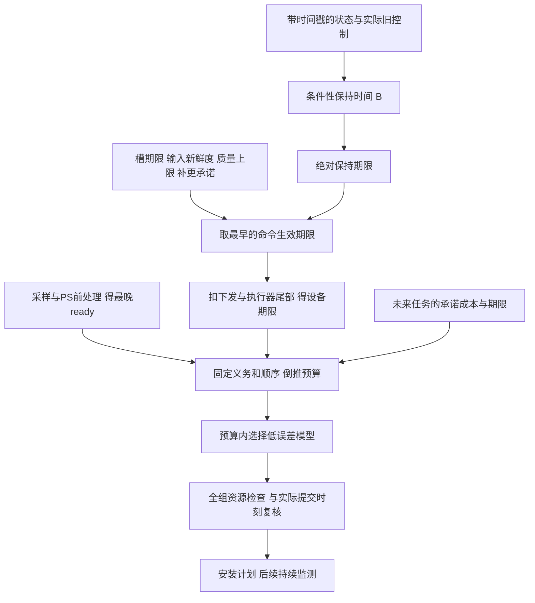

# Obligation-Protected Budget Allocation for Shared DPU Control

> 路线 B 的审查、修订设计与验证计划 · 2026-11-16  
> 正文中文；保留 [2026-11-15 原论文稿](ROUTE_B_PAPER_DRAFT_20261115.md)。本文是新研究规格，不代表运行代码已按本文全部修改。此次没有训练、重新量化、启动 AirSim 或开展新板端试验。

## 阅读导引

这份文档回答一个问题：**多架无人机共享一个 DPU 时，怎样在不破坏其他飞机更新义务的前提下，把可用计算时间分配给更有价值的控制更新？**

全文分三层：第1～3节说明已有证据和时间模型；第4～10节给出可解释的算法；第11～15节说明开销、实现差距、实验与下一步。涉及“已实现”均指现有源码；“本版规定”均是待落实的修订设计。

建议先看第1节的结论、第7节的跳更算例、第10节的完整流程，再读推导。符号和数字算例的时间单位为毫秒，除非特别注明。算例用于解释公式，不是飞行测量。

## 1. 审查结论：保留主线，撤回没有证据的承诺

### 1.1 研究主线应当是什么

建议收敛为：

**保护已经承担的控制义务 → 倒推出当前可使用的连续设备时间 → 在预算内选择误差较低的控制器 → 只在证据支持时重新分配更新义务。**

这里“控制义务”是某个 UAV 必须在某时刻前得到一条有效新命令。它包括正常更新，也包括跳过一次后留下的限时补更。

核心是一个调度问题：**眼前看似空闲的 DPU 时间，有多少已经被未来紧急更新、输入准备和命令下发占用了？** 不应把五个变量全部交给一个黑盒，也不应把“模型更大”“周期更短”预设为更安全。

建议的层次如下。

| 层次 | 本版定位 | 当前能否直接开展 |
| --- | --- | --- |
| 倒推预算 + 整任务调度 + 预算内选模 | 最小核心 | 已有运行基础；需修正若干一致性缺口 |
| A/B/C 必要条件与有限修复 | 核心的诊断工具 | 已有回放；需区分下界证据与经验预算失败 |
| 改未来周期 | 控制任务到达率的辅助动作 | 已有历史真板触发；新日历接入批次未触发 |
| 跳一次并保护补更 | 可选的义务调整 | 状态机已有；当前闭环收益和资格尚不足 |
| 原计划可行时主动跳更换取质量 | 新增的条件扩展 | 缺统一闭环收益数据；先做影子评价 |
| 分段执行 | 硬件验证后的独立扩展 | 当前部署不支持应用可控的段间恢复 |

**“原计划可行就绝不跳过”不应成为理论定律；但在缺少跳更损失证据时，保留更新仍是合理的默认实现。** 本版允许在数据齐备后打开质量驱动跳更，不凭空赋予平稳状态零代价。

### 1.2 原方案逐项审查

| 原设计或表述 | 判断 | 本版修订 |
| --- | --- | --- |
| 三类绝对期限统一约束命令交付 | 保留 | 明确真实生效与 RPC 返回不同，补充质量保持上限和时钟误差 |
| 给定顺序的倒推预算 | 保留 | 是固定资源模型下的时序判据；不能替代物理安全或完整 PS 检查 |
| 状态相关“物理合格模型集合” | 证据不足 | 当前改称部署/实验候选池，不能用 MSE 或共同候选列表冒充安全资格 |
| 用更小网络解决超载 | 有条件成立 | 只能在候选池内减需求；最小需求都超容量时继续换模无效 |
| 排除 A/B 后一律归 C | 过强 | 改为“未定位”；只有存在可行重排才确认顺序可修复 |
| 一次跳更会释放整条 DNN 的算力 | 错误的直觉 | 计算扣除补更后真正增加的连续预算，可能很小、为零或为负 |
| 早弯不宜漏更、晚弯可漏更 | 只能作为待验证假设 | 现有结果是特定状态下漏两次的差异，不是一次跳更资格表 |
| 保留计划可行时永不跳更 | 作为默认合理，作为绝对规则过强 | 有同一闭环指标的配对收益证据后允许主动跳更 |
| 只要首段能装入窗口就启动分段网络 | 不成立 | 启动前登记全部剩余段及最终交付义务 |
| 有界候选数意味着硬实时 | 不成立 | 还需管理任务响应上界、锁等待、通信和执行成本上界 |
| 新鲜状态总能延长保持期限 | 不成立 | 必须匹配实际旧控制；已承诺补更期限默认只能收紧 |

### 1.3 当前最重要的事实

现有新量化模型和调度接入已经能够运行，但**尚未证明“完整新策略比公平优化的静态策略更安全且质量更好”**。

新18档成本驱动的合成回放中，换模已经解决绝大多数可修复场景，继续加入重排、改期、跳更没有增加通过数。这不是应当隐藏的坏结果，而是提醒我们：应先证明新机制解决了哪一种真实剩余困难。

## 2. 已有证据：哪些结论可以用，哪些不可以

| 证据 | 实际做了什么 | 可以支持什么 | 不能支持什么 |
| --- | --- | --- | --- |
| 160个小规模场景 | 147个原配置时序失败，有限 Oracle 可修复131个；5次检查内 ABC 130、带派发保护131 | 在指定动作空间中，诊断能减少无效检查 | 真实飞机救回131次、通用最优调度 |
| 旧480场景 | 无跳更325、含相位/补更326；8 ms预留且限制已发布修改后29 | 可修改窗口和决策延迟重要；跳更额外收益很小 | 297个损失全部由算法算得慢造成 |
| 60,000次数值自检 | 固定序列前推与倒推一致，包含给定的保留/撤回日历 | 代数判据的一致性 | 在线顺序选择、物理资格、模式切换、实现线程均正确 |
| 新18档成本回放 | 共480场景、5种方法，即2400次决策 | 在新成本和有限 PS/DPU 模型下运行完整检查 | 新量化控制器的闭环跳更收益 |
| 早/晚弯漏更新 AirSim | 固定 FP32、特定历史状态，相同两次漏更在不同阶段后果不同 | 控制损失有状态/相位依赖 | 所有晚弯可跳、一次跳更安全、新 INT8 也相同 |
| 11月16日真实5239接入 | 单机真实换模40次；双机动态换模3次 | 模型选择确实到达真实 DPU | 超网、分段抢占、主动跳更已上板 |

新成本回放按每组160场景计数：

| 名义决策预留 | 固定配置 | 允许换模 | 再加重排 | 再加改期 | 再加跳更 |
| --- | ---: | ---: | ---: | ---: | ---: |
| 0.5 ms | 18 | 156 | 156 | 156 | 156 |
| 3 ms | 18 | 154 | 154 | 154 | 154 |
| 8 ms | 1 | 25 | 25 | 25 | 25 |

这张表与旧的“326→29”是不同实验，不能合并计算改进幅度。旧实验没有在现有报告中给出决策时间与锁定规则的独立归因；需要第13节的二因素复核。

新实飞在4 m宽门、明确的参考匹配飞行初态下：单机400/400按期；双机固定800/800按期；双机动态799交付、1条在发送 DPU 前被丢弃。均通过全部门。固定模型ID6只是接入对照，不是全局最优静态配置。本批没有周期改变或计划跳更，不能据此宣传这些机制有效。

来源：[160场景](ROUTE_B_ACTION_REPLAY_20261109.md)、[旧480场景](ROUTE_B_PHASE_AWARE_FRAMEWORK_20261114.md)、[原稿数值自检](ROUTE_B_PAPER_DRAFT_20261115.md)、[新成本回放](ROUTE_B_RELEASE001_IMPLEMENTATION_20261116.md)、[新实飞与原始报告](ROUTE_B_LIVE_RELEASE001_20261116.md)。本次审查没有改写这些历史数字。

## 3. 统一时间模型：控制还没更新时，到底是谁在保护飞机

### 3.1 一条任务的时间轴

设 UAV 为 $i$，第 $k$ 次控制任务为 $j=(i,k)$。全部时间映射到同一个单调时钟，并记录转换误差。

| 符号 | 意义 | 必须避免的混淆 |
| --- | --- | --- |
| $r_j$ | 按绝对日历发布任务 | 发布不等于输入已经准备好 |
| $s_j$ | 构造该任务输入所用状态的实际采样时刻 | RPC请求开始时间只是当前实现的代理 |
| $q_j^{obs}$ | 输入已准备好、可交给设备的实际时刻 | 不是 release |
| $\hat q_j$ | 预计 ready 时刻 | 预测，不是保证 |
| $q_j^{ub}$ | 在给定资源安排下可信的最晚 ready 上界 | 没有上界证据时只能称经验包络 |
| $v_j,f_j$ | 设备开始、设备完成 | 不含尚未定义的下发耗时 |
| $a_j$ | 新命令实际开始生效 | DPU完成、命令返回都不自动等于它 |
| $R_j=a_j-r_j$ | 发布到生效的端到端响应时间 | 不只是 DNN 推理时间 |
| $t_x$ | 保持分析所用的最新物理观测时间 | 可与 $s_j$ 相同，也可以来自独立监测 |
| $a_{old},u^{old}$ | 当前生效控制的起点及实际限幅后的控制量 | 不能用尚在排队的 DNN 输出替代 |

```text
旧控制开始 a_old ─────────────── 持续作用 ─────────────── 新控制生效 a_j
                      观测 t_x             ↑               ↑
任务 j：           release r_j → 采样 s_j → 输入 ready → DPU → 下发/执行器
                                  |              |         |
                              fresh 起点         v_j       f_j

保持期限从 t_x 的真实状态推导；输入新鲜度从 s_j 推导；任务槽从 r_j 推导。
三者不必使用同一个起点。
```

已有 Windows 实现主要用命令 RPC 返回作为交付代理。要声称约束真实 $a_j$，还需测量/约束 RPC 与执行器生效的差值；跨 Windows、板端、仿真时钟也必须核对。本文不会把代理升级为已测到的电机时间。

### 3.2 三期限及额外质量上限

对已发布任务，槽期限冻结为发布时的下一次计划 release：

$$
d_j^{slot}=r_j+T_j^{slot}.
$$

改变未来周期不能把已经发布任务的期限顺延。若用户要求“一个周期内完成并释放资源”，还需检查任务完成清理时刻 $z_j\le d_j^{slot}$，而非只检查 $a_j$。

输入新鲜度定义为：**用这份输入计算的新命令最晚何时允许生效**，不是采样最晚完成时间：

$$
d_j^{fresh}=s_j+F_i.
$$

当前 $F_i$ 默认80 ms，是工程门槛，不是已证明的物理极限。未来任务还没有 $s_j$：若采样保证不会早于 $r_j$，暂用 $r_j+F_i$ 是较紧的占位期限；不能用一个乐观的未来采样预测把期限往后推。

物理保持期限及独立的最长更新间隔为：

$$
d_i^{hold}=t_x+B_i(x_i(t_x),u_i^{old}),\qquad
d_i^{quality}=a_{old}+H_i^{max}.
$$

$H_i^{max}$ 是控制质量/开发设置，不能因为重新观测就不断刷新。存在补更时，再加冻结的 $d_i^{rec}$：

$$
d_j^{act}=\min\{d_j^{slot},d_i^{hold},d_j^{fresh},d_i^{quality},d_i^{rec}\}.
$$

无补更时 $d_i^{rec}=+\infty$。若为了保留原文“三期限”记法，可把 $d^{quality}$ 和 $d^{rec}$ 合并到有效保持期限中，但日志必须分别记录来源。当前 `safe_deadline()` 已把物理保持与最长更新间隔取最小；不能再声称其返回值全部来自纯物理 $B$。

### 3.3 为什么固定周期不等于固定命令间隔

因为 $a_k=r_k+R_k$，而 $r_{k+1}-r_k=T_k$，所以：

$$
a_{k+1}-a_k=T_k+R_{k+1}-R_k.
$$

例如发布在0、50 ms，响应为10、18 ms，命令生效在10、68 ms，实际保持了58 ms。发布周期仍是50 ms。

原始 $T+R\le B(x)$ 是特定起点下的充分检查：

- 若在观测 $t_x$ 时预计还要等 $\delta r=r_{next}-t_x$ 才发布下一任务，则正确形式是 $\delta r+R_{next}^{ub}\le B(x(t_x),u^{old})$。
- 只有当 $\delta r=T$，或者把 $T$ 作为这段等待的上界时，才简化成 $T+R^{ub}\le B$。
- 若 $B$ 从 $a_k$ 起算，则应检查 $T_k+R_{k+1}-R_k\le B(x(a_k),u_k)$。忽略非负 $R_k$ 可得到更保守的 $T_k+R_{k+1}^{ub}\le B$。
- 有跳更时必须用下一条真正保留的任务；不能仍用被跳过的50 ms槽来计算等待。

观测在80 ms、$B=40$ ms，决策在95 ms结束：绝对保持期限是120 ms，剩余25 ms。不能从95 ms再加40 ms。

## 4. B(x,u) 的实际含义与保证边界

### 4.1 现有实现已经比“横向距离除速度”丰富，但仍有假设

[held_control_safety.py](../held_control_safety.py) 使用：位置、速度、姿态四元数、实际保持的推力加速度和机体角速度命令；另有门框几何、机体膨胀半径、净空、位置/速度/加速度误差界及最大保持时间。并不是直接使用237维输入的全部分量。

NED 坐标中，名义加速度为：

$$
a_{nom}=g e_3-F R(q)e_3.
$$

在固定推力、按保持角速度演化的名义模型下，使用 $J=F\|\omega\|$ 约束名义加速度变化。执行器跟踪滞后、模型不匹配及所考虑的扰动需要由明确误差界覆盖；这些界目前并未完成严格标定。这里的误差界不要求向实验注入人为扰动，但必须覆盖现实模型误差。

对膨胀门框某个外侧分离平面 $h=n^Tp-b$，记：

$$
h_0=h(t_x)-\epsilon_p,\quad
w=n^Tv(t_x)-\epsilon_v,\quad
z=n^Ta_{nom}(t_x)-\epsilon_a.
$$

代码给出的区间下界为：

$$
h''(\tau)\ge z-J\tau,
$$

$$
h'(\tau)\ge w+z\tau-\frac{J}{2}\tau^2,
$$

$$
h(\tau)\ge h_0+w\tau+\frac{z}{2}\tau^2-\frac{J}{6}\tau^3.
$$

再检查 $h''+2\kappa h'+\kappa^2h\ge0$，以及初始 $h_0>0$、$w+\kappa h_0\ge0$。实现将多项式的正的高阶系数降为0，形成单调保守下界，用24次二分求可覆盖的整个时间前缀。不是只检查末点或几个离散点。

每个门框条是有限长盒体。对一个盒体，选择能在整个区间保持分离的一个面；再对所有盒体取最短保持时长。它保护的是这些已建模门框，不自动覆盖 UAV 互撞、未建模建筑或任意障碍。

### 4.2 保证方向必须准确

若动力学、几何、误差管和生效时间等假设真的成立，得到的 $B$ 是**真实可安全保持时长的保守下界**：允许承诺的等待不得超过 $B$。它不是“真实第一次撞击时刻的上界”。

当前应称为**基于未完全验证误差界的条件性保持估计**。代码中 `plant_bounds_verified` 的布尔标志不能代替实验证据或数学验证。$B=0$ 表示这个方法没有发出证书，不等于马上一定撞击；$B>0$ 也不代表假设已被证实。

### 4.3 旧控制可保持，不等于新 DNN 输出安全

$B(x,u^{old})$ 只回答“这条已经生效的命令还能维持多久”。它不能证明新模型的输出不会把飞机带向门框。

本版把两件事分开：

1. 调度层保护旧命令的保持期限，尽量及时交付下一条命令。
2. 控制层需要独立验证候选模型的适用域，以及新命令是否可接受。

现有输出范围、有限值、限幅和异常退出检查只是接口/运行保护，不是一般状态下的新命令安全证明。将来可对已算出的新输出再做短时保持检查，但那也是依赖相同误差界的条件证书，而且不能在输出还没计算时假装已经通过。此项不写成当前完成的功能。

### 4.4 跳更后要持续监测，但不能靠重新计时掩盖风险

必须继续接收带时间戳和当前控制版本的状态；跳过 DNN 更新不应同时关闭监测。发现保持期限缩短时，冻结的补更期限取旧、新值的最小值，触发修复。若需要更早补更，仅允许在尚未发布时提前，并重新检查全组；不允许推迟欠账。

即使重新检查频繁，也不能补救一个已经失效的旧证书。监测、识别、修复本身的响应时间必须留在原保持窗口内。已生效控制版本不匹配的观测不得用于续期；一次新观测也不自动延长已承诺补更的期限。

## 5. 端到端成本怎样进入设备预算

### 5.1 先定义资源边界，再写公式

把一次控制分成：

$$
\text{release}\to\text{采样/PS前处理}\to\text{DPU服务}\to
\text{PS后处理/下发}\to\text{执行器生效}.
$$

设 $P_j^{ub}$ 包含采样与前处理的执行及排队上界，$L_j^{out,ub}$ 包含 DPU 之后的后处理排队、下发和执行器延迟，则：

$$
q_j^{ub}=r_j+P_j^{ub},\qquad
D_j=d_j^{DPU}=d_j^{act}-L_j^{out,ub}.
$$

$P_j^{ub}$ 需要在具体 CPU/通信资源安排下成立；不能把一次测得的前处理执行时间直接当成所有竞争条件下的 ready 上界。

| 成本 | 在哪里扣 | 避免的错误 |
| --- | --- | --- |
| 管理决策响应 | 推迟可提交/可启动时刻，并在实际占用的 PS 上登记 | 每个任务都重复扣整段决策时间 |
| 采样、输入构造和其排队 | $q_j^{ub}$ 或显式 PS 前处理任务 | 在 $q$ 和 DPU 时长里各扣一次 |
| DPU调用/量化/拷贝 | 根据服务边界放进 $p_j$，或拆成显式资源阶段 | 板端 service 已含拷贝却又额外相加 |
| 网络往返 | 当前单请求协议可建模为串行设备服务占用；未来流水化需拆资源 | 把 UDP 往返全部叫 PL 计算时间 |
| 后处理、命令通信、执行器 | $L_j^{out,ub}$，或完整流水线检查 | 忽略返回到实际生效的差值 |
| 已运行任务 | 资源的剩余不可抢占占用 | 同时当完整任务和额外阻塞重复计算 |

现有实时适配器把板端服务成本加3 ms网络余量，并用观测到的板端往返耗时向上更新。这是在建模**串行板端请求服务器**，不是纯 DPU 运算时间。现有 profile 的最大观测值/P99 都不是认证 WCET。

### 5.2 一个可手算的链条

观测在80 ms、$B=40$ ms，故 $d^{hold}=120$；槽期限130、输入新鲜期限125、质量期限140，得到 $d^{act}=120$。如果可信下发尾部为5 ms，则 $D=115$。

在100 ms时，当前任务已经 ready。后续两任务为：

| 后续任务 | $q$ | $p$ | $D$ |
| --- | ---: | ---: | ---: |
| 1 | 100 | 4 | 109 |
| 2 | 106 | 3 | 114 |

倒推可知它们最晚分别从105、111 ms开始。因此当前任务最多占用 $\min(115,105)-100=5$ ms。候选成本2、3.2、5 ms都能在设备层容纳；选哪档还看误差评分及完整资源检查。

**这个5 ms是计算时间预算，不是物理净空，也不是新的安全证书。**

### 5.3 从物理状态到配置的完整关系

$$
B(x,u^{old})\ \longrightarrow\ t_x+B=d^{hold}
\ \longrightarrow\ d^{act}\ \longrightarrow\ D=d^{act}-L^{out,ub}
\ \longrightarrow\ b_i(e)\ \longrightarrow\ c_i^*.
$$



每次结果应同时报告“时序模型通过”“保持模型通过”“物理/计时假设是否已验证”。如果前两项通过而第三项未完成，就属于条件模型内通过，不能缩写成严格安全。当前最小运行版本属于这一层级。

## 6. Backward Budget：精确部分和近似部分分开

### 6.1 固定顺序的判据

给定单一不可抢占资源、固定后续顺序 $(j_1,\ldots,j_n)$、固定就绪时刻 $q_j$、固定执行成本 $p_j$、设备完成期限 $D_j$。未来顺序可以等待尚未 ready 的任务，但不能擅自越过它。

$$
\ell_n=D_{j_n}-p_{j_n},
$$

$$
\ell_k=\min\{D_{j_k},\ell_{k+1}\}-p_{j_k}.
$$

尾序列可行必须满足每个 $q_{j_k}\le\ell_k$。若当前任务 $i$ 在资源实际可启动时刻 $e$ 已 ready，则其连续预算为：

$$
b_i(e)=\min\{D_i,\ell_1\}-e.
$$

空尾序列取 $\ell_1=+\infty$。当前候选成本满足 $p_i\le b_i(e)$ 且所有尾项 ready 检查通过，等价于这个**固定设备顺序**可以前推完成。这里 $e$ 已含当前不可抢占占用和决定可生效时间，不能简单总取快照时间 $t$。

推导很直接：最后一项必须在 $D_n-p_n$ 前开始；倒数第二项既要满足自己的完成期限，也要给最后一项留下足够时间，依次倒推。如果任一任务直到其最晚开始时间之后才 ready，前面的空闲也救不了它。满足全部条件后，按 $v_k=\max(q_k,f_{k-1})$ 前推即可验证。

这一结论要求成本中已经一致地包含固定顺序对应的切换代价。若切换成本依赖前一模型，改变头任务也会改变尾首项成本，必须重新带入，不能套用旧尾缓存。

### 6.2 哪些 $p_j$ 可以使用

**通过的日历必须使用实际承诺的模型成本。**

最快候选可用于构造一个乐观修复方案；若这个方案通过，意味着后续任务也承诺使用那些快模型。不能检查时人人用小模型，执行时人人换大模型。

例如后续任务在10 ms前完成，保留模型成本6 ms，当前从0开始最多用4 ms。若偷偷用2 ms小模型倒推，预算变8 ms；随后又让后续任务恢复6 ms，原承诺就失效。

提高某个模型档位时，必须重算受影响预算，并完成必要的全组检查。已经实际在 DPU 中运行的任务不能换档，也不能按新小模型估计其剩余时间。

### 6.3 三种证据等级

| 输入 | 结论 |
| --- | --- |
| 确定的 $q,p,D$，固定设备顺序 | 对该单资源模型的精确可行性判断 |
| P99、经验最大值、预计 ready | 经验预测/候选筛查；可能在尾延迟下失败 |
| 可信 ready/执行/下发上界，并检查共享资源和时钟 | 可以在明确假设内支持实时保证 |

现有 `tail_budget()` 明确是乐观 PS-ready 筛查：前处理时间没有独立加上完整 PS 等待。最终 `evaluate()` 会模拟共享 PS/DPU 和每机槽重叠。因此当前倒推值不能独立批准派发。

未来任务的物理期限同样有不确定性：现有第二未来槽假设第一条新命令成功后重新获得保持资格，但尚未计算那条新命令。这个未来保持界是条件占位，不能支持无限期物理安全保证。

### 6.4 顺序从哪里来

本版规定下列低开销规则，区别于随意枚举排列：

1. 已通过且上下文仍有效的日历优先沿用，保持正在运行的请求及补更承诺。
2. 初始化或重建时，以 $D_j$ 升序为基线，同期限按原顺序、release、任务ID稳定排序。
3. 就绪队列中，优先尝试基线头任务；若未来紧急任务要求暂时留空，允许受检查的空闲，不能一看到 ready 就盲目填满 DPU。
4. 原顺序失败且未被必要条件排除时，最多尝试两个替代头：最紧迫的 ready 任务、最快的 ready 任务；其余保留 EDF 尾序列，重复方案去重。
5. 重排改变了阻塞和 PS 后处理顺序，要重新验证。替代方案均失败只说明本次有限候选没找到解，不证明没有其他可行排列。

这里 Guarded EDF 指“启动前检查是否挤占已知未来紧急义务的 EDF”，是本文明确的基线规则，不借这个名字暗示某种已证明最优的新算法。

### 6.5 增量更新实际能省多少

固定顺序第 $k$ 个任务的成本或期限改变，首先影响 $\ell_k$，再向**前缀** $k-1,\ldots,1$ 传播；并非只更新后面的尾序列。未变的后缀可缓存，传播值不变时可以提前停止。最坏仍为 $O(n)$。

仅 $q_k$ 变动且其他独立条件不变，可更新这一项 $q_k\le\ell_k$；但是在真实共享 PS 上，ready 变化也可能影响其他任务，不保证是一次常数时间更新。改 release、跳更、插入补更、重排或改变 PS 工作量，通常还要重建窗口并做完整检查。

现有代码每次重算，没有实现本文的增量缓存。60,000次旧数值自检只支持固定序列代数，不覆盖缓存失效规则。

## 7. 现实可行的选模与跳更收益

### 7.1 先把“候选池”与“物理安全集合”分开

当前定义部署候选池 $\mathcal P_i$：契约、归一化、量化身份、输入范围与输出接口匹配，且未被现有实验明确排除的模型。它可以显式限制在已经复核的任务域内，但不能命名为任意状态下的安全集合。

普通教师拟合误差采用冻结尺度：

$$
E(c)=\frac{1}{4N}\sum_{m=1}^{N}\sum_{h=1}^{4}
\left(\frac{u_{c,h}(x_m)-u_{teacher,h}(x_m)}{\sigma_h}\right)^2.
$$

尺度 $\sigma_h$ 来自固定数据契约；不重新按某一模型单独缩放。当前实现用 TRAIN512 选择评分，480条核对样本作独立报告，不回流挑配置。

现阶段真正可运行的直接选模公式是：

$$
c_i^*=\arg\min_{c\in\mathcal P_i:\ p_i(c)\le b_i(e)} E(c).
$$

这是“预算约束下教师拟合误差最小”，不是“物理控制最优”。空集时进入修复或报告无可认证配置，不能把预算改大。近似平分时选更便宜或原模型；不因极微小点估计差异频繁换模。

新数据的一个例子：ID8与ID11的 TRAIN512 MSE 约0.003293和0.003289，服务最大观测约0.969和1.330 ms。只多出来的约 $4\times10^{-6}$ 误差改善尚无闭环意义证据，不能默认值得多花0.361 ms。使用固定最小改善阈值或置信区间重叠时保留便宜模型更合理；阈值需在开发集冻结。[数据来源](ROUTE_B_RELEASE001_IMPLEMENTATION_20261116.md)

### 7.2 三种误差不能混用

| 量 | 如何得到 | 用途 |
| --- | --- | --- |
| 总体教师 MSE $E(c)$ | 固定离线输入与教师输出 | 最小版的低开销质量代理 |
| 关键状态教师误差 $E(c,g)$ | 对冻结关键状态分组复算，包括分位数 | 分析总体平均是否掩盖弱点，不等于恢复概率 |
| 闭环损失 $L_i$ | 相同初态、路线、命令时序下实际飞行 | 判断模型升级、漏更、延迟是否真的有控制收益 |

以后可按转弯阶段、归一化位置误差、向边界横向速度、输入年龄分成少量组。组边界应由物理量和开发数据预先定义，并留出独立路线；无需为每个连续状态造一个硬编码格子。

分组只提供有限域内的经验资格及不确定性。数据不足的组标为未知：不允许凭“平稳”获得跳更额度，不宣称任意模型安全。若冻结基线在其验证域内仍可运行，就保留更新、继续监测；若状态已超出全部资格，明确报告无法认证并执行既有异常处置。当前请求悬停也不是一个已证明的安全恢复控制器。

**未知不必等于立即结束所有探索飞行；但探索继续和安全批准必须分开记录。** 严格验收时未知资格不能当作通过。

### 7.3 跳一次究竟是什么操作

本版沿用：在 release 前撤回一个尚未发布的控制 job，保留周期 $T$；把原本紧邻下一周期的 job 标为不可再次跳过的补更。它不是自动增加一个额外任务，也不是静默把全局周期翻倍。

例：原控制在10 ms生效，后续 release 为50、100 ms。跳过50 ms槽，100 ms槽若需要10 ms响应，实际补更在110 ms，而不是100 ms。

若最新观测在40 ms，$B=80$ ms，则旧控制保持期限120 ms，110 ms可以满足这条约束；若 $B=65$ ms，期限105 ms，则不能批准。还要分别满足输入新鲜、任务槽、最长更新间隔及其他 UAV 的期限。

跳过时建立恢复债务：

$$
\mathcal D_i=(\text{successor ID},\ d_i^{rec},\ \text{held-control version}).
$$

债务未清偿，禁止再跳；补更期限不得放宽。模型可在未运行前重选，但须全组复核；时间只可依法提前，不能延后。新命令在全部有效期限内交付且版本核对通过才清债。仅有 DPU 输出或迟到的 RPC 返回都不够。

当前已有禁止欠账再跳和限时补更状态机；没有“所有时序字段已到真实执行器层验证”的证据。

### 7.4 真正释放的预算是净值

保持其他比较条件相同，分别构建保留日历 $\Pi^{keep}$ 与撤回并加入补更义务的日历 $\Pi^{skip}$：

$$
\Delta b_i=b_i(\Pi^{skip})-b_i(\Pi^{keep}).
$$

两者应使用同一个时间起点、相同非参与任务承诺，均覆盖受影响未来槽。若一个尾日历不可行，不要把其空结果当成0来相减；用“修复失败→成功”单独报告。

手算例：计划在0 ms之前提交，设备从0开始执行 A，其设备期限为8。C固定周期5 ms，当前槽C1在0发布，下一槽C2在5发布；另有飞机X的一条保留任务。为简化只看设备，前后处理已在其他预算中处理，ready分别为0、0、5。

| A之后的固定尾序列 | 成本 | 保留时设备期限 | 跳C1后设备期限 |
| --- | ---: | ---: | ---: |
| C1 | 2 | 5 | 撤回 |
| X | 3 | 20 | 20 |
| C2 | 2 | 10 | 8.5，受原旧控制保持约束 |

- 保留：倒推C2最晚8开始，X最晚5开始，C1最晚3开始，A预算3。前推是A:0–3、C1:3–5、X:5–8、C2:8–10。
- 跳C1后：C2最晚6.5开始，X最晚3.5开始，A预算3.5。前推是A:0–3.5、X:3.5–6.5、C2:6.5–8.5。
- 少做了2 ms计算，但 A净增只有0.5 ms；补更更早完成的义务限制了X，也反过来限制A。
- 如果补更期限收紧到7.5，则C2最晚5.5开始、X最晚2.5开始，A预算2.5，净值为负；C2在5 ready，仍能满足这个设备序列。

若C2因前处理直到7 ms才ready，8.5 ms补更期限下的6.5 ms最晚开始就被违反，方案不可行。不能让补更在原下一周期发布之前执行，以制造正净预算。

### 7.5 保留可行时，何时值得主动跳更

用户给出的 A 三档成本2/3.2/5 ms、MSE 0.10/0.04/0.02可解释为：预算3只能用小模型，预算3.5可升中模型。但 **0.06 的 MSE 改善本身不能证明值得跳掉 C 的一次控制**。

先选统一闭环损失，例如固定物理时窗 $H$ 内：

$$
L_i(\Pi)=\frac{1}{H}\int_t^{t+H}
\left[w_p\frac{\|p_i-p_i^{ref}\|^2}{p_0^2}
+w_v\frac{\|v_i-v_i^{ref}\|^2}{v_0^2}\right]d\tau
+w_f\frac{\|p_i(t+H)-p_i^{ref}(t+H)\|^2}{p_0^2}.
$$

$p_0,v_0,w_p,w_v,w_f,H$ 在实验前冻结，所有 UAV 口径相同；权重有不同任务优先级时也须预先声明。碰撞、越界、保持期限等仍为独立约束，不用这个加权损失掩盖。提前失败的轨迹不能只在较短时窗上积分而获得低分。

用配对闭环数据估计：受益回路的损失下降下界 $G_A^-$、被跳回路损失增加上界 $H_C^+$、其他受影响回路增加上界 $H_{others}^+$。这些是数据置信范围，不是确定性的安全保证。

$$
V^-=G_A^- - H_C^+ - H_{others}^+ -\eta K_{extra}.
$$

$K_{extra}$ 可取新增切换/管理占用除以固定时窗的无量纲代价；时间可行性中仍按实际时间计入。统一指标后默认各回路同权，不必再任意加入 $\lambda$。如果确有业务优先级，可固定 $\lambda_i$，但不能用它抵消物理约束。

批准质量型跳更需同时满足：

$$
\text{GlobalFeasible}(\Pi^{skip})\ \land\ \text{HoldEligible}(C)
\ \land\ V^->\theta\ \land\ \text{NoRecoveryDebt}(C).
$$

纯教学数字：若配对数据给出 $G_A^-=0.025$、$H_C^+=0.006$、其他损失0、额外代价0.002，则 $V^-=0.017$。阈值 $\theta=0.01$ 时可以考虑；若 C损失为0.030则 $V^-=-0.007$，不跳。**这些数不是本项目已测值。**

若没有可靠配对数据，$V^-$ 应为“未知”，不是0。当前最小版关闭质量型主动跳更，只记录这些候选在影子分析中的预算变化；先用第13节的物理实验建立少量可复核证据，不必训练复杂损失神经网络。

### 7.6 三种决策必须分开记账

| 状况 | 决策条件 |
| --- | --- |
| 保留日历不可行，跳更能修复 | 仍须已验证的保持/跳更资格、损失限额和全组时序；安全约束不能因“救急”取消 |
| 保留可行，跳更提升总体质量 | 必须有同口径、含其他回路影响的正收益下界，并超过阈值 |
| 保留可行，收益很小或未知 | 保留；不能因为能省算力就自动跳 |

设置最小收益阈值、每机跳更冷却窗口和禁止连续跳更，可减少频繁交换。冷却窗口和模型驻留用于质量优化，不得阻止必要的及时安全修复。参数应在开发集冻结，不用独立测试轨迹调参。

## 8. A/B/C 的正确职责：排除无效动作，而非强行分类一切

### 8.1 下界用来排除，上界用来承诺

必须同时标记成本的来源和方向：

- $C^{lb}$ 是可信最短执行下界，用于证明即使最理想情况也来不及。
- $C^{ub}$ 是可信最长执行上界，用于承诺最坏情况仍来得及。
- $\hat C$、P99、观测最大值是测量统计或经验包络；不能仅改名就成为上述任一个证明量。

没有可信下界时，允许报告“当前预算模型下无可行候选”，不报告“物理上绝不可能”。没有可信上界时，通过结果是经验模型可行，不是硬实时证明。

### 8.2 A：发布/输入链路太晚

对当前尚未发布任务，乐观独占设备的最早完成仍满足：

$$
\max(t,r_i)+P_i^{lb}+C_i^{min,lb}+L_i^{out,lb}>d_i^{act},
$$

那么不改变 release 或其他前置链路，只重排 DPU 无法修复。若 $C_i^{min,lb}$ 已取全部允许模型的下界，换模也不能修复。

例：$r=30,d^{act}=35$，忽略前后处理后最快合法模型仍至少8 ms，最早38 ms，单独改顺序无效。若当前时刻20 ms，将尚未发布任务提前到25 ms可在33 ms完成；若当前已到29 ms，即使立即发布也至少37 ms，属于反应已经太晚。

当前时刻反应余量可写成：

$$
M_i^{react}=d_i^{act}-t-L_i^{min,lb}.
$$

负值是“最快可用反应也太迟”的证据；非负值不保证共享资源下可行。

**A类并不要求平稳飞行中30 ms必然优于120 ms。** 它只描述某次关键更新的到达时间窗口。周期在常规区间收益小，与特定状态下“下一条关键任务发得太晚”并不矛盾。应通过实际关键时窗实验确认 A 在本任务里出现多少次，不能仅靠人工例子就把它当主要收益。

### 8.3 B：必要计算需求超过容量

对窗口 $I=[u,v]$，取所有必须执行、不能在 $u$ 之前开始且必须在 $v$ 之前完成的设备工作 $\mathcal J(I)$。单核设备可用容量为 $A(I)$，若：

$$
\sum_{j\in\mathcal J(I)} C_j^{lb}>A(I),
$$

则单纯换顺序不可能让这批义务全完成。实际检查还应计入跨窗在途工作及不可抢占阻塞；这个简单式子只是一个必要条件，没触发不等于全组可调度。

两个任务当前各8 ms、共同窗口12 ms，当前模式共16 ms，需减少需求。若允许一个模型降为4 ms，共12 ms，容量必要条件恢复，但仍要检查 ready、PS和顺序。

这里必须区分两种总和：

- 当前承诺成本超容量，最小允许成本未超：换档可能有效。
- **最小允许成本总和也超容量：继续换档不可能解决。** 只能在允许的控制契约内减少未来到达/跳更，或增加真实容量；若这些都不允许，就报告不可行。

把未来平稳回路周期放长只减少未来需求，不能消除已经发布的工作。不得在计算中让已发布任务凭空消失。

### 8.4 C：已找到顺序/阻塞可修复的证据

两个 ready 任务 A成本6、期限12，B成本5、期限7：先A后B，B完成于11而迟到；先B后A，完成于5和11，均按时。这是明确的顺序修复证据。

但 A/B 必要条件都没触发，仍可能存在不可抢占阻塞、PS冲突、相位约束、陈旧输入等困难。本版先标“未定位”，最多尝试两个受控重排。只有找到可行重排后，才将该次失败归为“顺序可修复”。

若未来具备真实分段能力，可在有完整剩余段承诺的条件下尝试段间让出，以减少不可抢占阻塞；这不是当前整任务版本已经实现的 C 类动作。

### 8.5 修复代价的简单排序

不固定永远先缩周期、再换模、再重排。使用证据决定尝试方向：

| 证据 | 优先尝试 | 明确排除/限制 |
| --- | --- | --- |
| A下界证据 | 提前尚未发布的关键槽；同时检查前处理路径 | 单独重排无效；已过最晚反应点不无限搜索 |
| B当前模式需求过大 | 对非锁定任务降档；必要时放宽未来平稳回路周期 | 已发布工作不随未来降频消失 |
| B最小模式仍过大 | 有资格的义务调整或报告不可行 | 不重复枚举更小但不存在的模型 |
| 原顺序失败、无A/B排除证据 | 有限重排，未来可加段间让出 | 不直接宣布C；失败后保留“未定位” |
| 混合原因 | 最多两个有针对性的联合修复 | 不做所有 $T,c,\sigma$ 笛卡尔积 |

一种可实现的降档候选生成规则是按“单位节约时间的代理损失”从小到大选：

$$
\rho_{j,c\to c'}=\frac{E(c')-E(c)}{p_j(c)-p_j(c')},\quad p_j(c')<p_j(c).
$$

它仅用于给候选排序，不证明闭环损失，也不保证在关键窗口里确实释放同样多预算。选到的少量改动仍要做窗口及全组检查。改变周期或跳更时，MSE分母不能替代闭环损失，按第7节的数据资格处理。

## 9. 分段：当前硬件结论及合理扩展

### 9.1 已核对到什么

当前 release001 板端源码使用 legacy DNNDK：`dpuLoadKernel()`、`dpuCreateTask()`、`dpuRunTask()`，产物是整网络 ELF。输入为原始237维，板端处理后按模型要求填充，返回4维物理控制。不是现代 VART `.xmodel`/Runner 管线。

[实际 pool237_runner.cc](main18_requant_release001_delivery_20261115/board_package_requant18_release001/pool237_runner.cc) 对一条请求调用一次 `dpuRunTask()`；模型切换发生在完整请求之间。未发现应用可调用的内部暂停、保存执行点、恢复下一层接口。多份 task/副本提供工作空间隔离，不自动构成网络分段。

官方 DNNDK 文档把 kernel 作为装载单元、task 作为具有私有工作空间的执行实体，并区分边界与内部节点。公开 API 列出整 task 运行、任务优先级和张量访问，但这不足以证明本部署可暂停正在运行的 kernel。[DNNDK UG1327](https://docs.amd.com/api/khub/documents/iKwn8npswBP~bjPxM4AEWg/content)、[UG1414 legacy C++ API](https://docs.amd.com/r/1.3-English/ug1414-vitis-ai/C-APIs)。后一个页面为1.3版；当前工具链为1.2.1，具体符号必须再由板端头文件和小程序验证，不能跨版本推断新增能力。

因此准确结论是：**现有包没有可调度的分段能力；把网络拆成多个单独可执行 kernel 在原理上值得做可行性验证，但当前没有对应编译产物、数值验收和测量。** 不能说“所有 Xilinx DPU 永远不能分段”，也不能说“调优先级就能中途抢占”。

### 9.2 可验证的最小硬件路线

先只选一个代表模型，固定切成两段：

1. 导出前半网络的输出张量、后半网络的输入张量，单独编译成可调用 kernel；验证这一版编译器确实接受这种图。
2. 建立边界张量的形状、布局、尺度、零点/取整、缓存一致性与身份契约。边界量化不同可能需要重定标，结果不一定逐位等同原整网。
3. 为每个在途 UAV/任务保留自己的中间张量与输入版本。复用一个 task 的缓冲区时，必须在覆盖前保存，或使用独立工作空间。
4. 运行前段A，完整返回后调度B，再运行A后段。这个是**kernel边界切换**，不是打断正在执行的 kernel。
5. 用黄金和独立输入检验拼接输出、误差与范围；再测是否值得付出拆分成本。

需要新的 kernel/ELF 和调度接口；可能需要多个 task，未必需要每个 UAV 复制一整份权重。当前接口称 task；将来改用 VART 才涉及 Runner。重新编译是必要验证步骤，重新训练是否必要取决于边界精度与支持情况，不能先承诺不需要。

测量至少包括：每段执行、启动/驱动、边界读写、DMA或拷贝、缓存刷新、重定标、切换恢复、工作空间峰值、并发干扰下尾分布。任务级总耗时减去整网耗时不能唯一分解这些成本；应分别计时再做总链核对。

### 9.3 纳入预算的方法

若模型 $c$ 有 $m$ 段，任务变为依赖链：

$$
(j,1)\prec(j,2)\prec\cdots\prec(j,m),\qquad f_{j,m}+L_j^{out}\le d_j^{act}.
$$

第 $h+1$ 段只有在第 $h$ 段及所需张量转移完成后才能 ready。原始输入的新鲜期限继续适用于最终输出，不能在恢复时重新刷新输入年龄。

对一条固定、依赖合法的段级序列，可将每段服务及相应切换成本放入第6节倒推；最终段继承交付期限，前面段由后续依赖反推最晚完成时间。完整验证应显式模拟依赖、DPU、PS/DMA及内存占用。**不能先只检查第一段，再寄希望于以后找时间完成剩余段。**

最大单段长度影响最坏不可抢占阻塞，但总成本为：

$$
C^{seg}(c)=\sum_h C_h(c)+O_{boundary}+O_{save/restore}+O_{transfer}.
$$

开销可能抵消缩短阻塞的收益，而且共享内存/带宽使简单求和不足以提供硬上界。有限抢占与分段粒度的这种取舍本身已有经典研究，不能把它作为本项目独创结论。[Limited Preemptive Scheduling for Real-Time Systems: a Survey](https://hipert.unimore.it/people/marko/papers/TII13.pdf)

### 9.4 一个分段真正可能有价值的算例

A在0 ms ready，需8 ms、期限12；B在5 ms ready，需2 ms、期限8。

| 策略 | 顺序 | 结果 |
| --- | --- | --- |
| 立即整网A | A:0–8，B:8–10 | B迟到 |
| 整网等待B | 空闲0–5，B:5–7，A:7–15 | A迟到 |
| A拆成4+4，先不计边界成本 | A1:0–4，B:5–7，A2:7–11 | 都按时 |

若 A1→B、B→A2各有0.2 ms串行边界成本，可以安排 A1:0–4、边界4–4.2、等待到5、B:5–7、边界7–7.2、A2:7.2–11.2，仍通过。若实际额外成本更大，必须重算。这里所有数字是算例，不能当本板测量。

网络执行了一部分以后：可以取消尚未运行的后续段，但已花成本不能收回，当前正在执行段不能按零时间取消。更换独立模型默认丢弃部分结果并从头计算；只有经过契约验证的共享前缀/超网才可能复用中间结果。复用不是当前 `ControllerBackend` 抽象已经证明的能力。

### 9.5 是否作为主要贡献

目前建议作为独立扩展。先完成固定两段的能力、精度和总成本验收；若真实阻塞足够大且拆分有净收益，再将其纳入主要评估。暂不加入“每次在线自动决定任意切分点”的第五个自由变量。

这样可保留研究方向，同时避免在尚未有硬件支持时构建一个只能在理想模拟中成立的主算法。

## 10. 改进后完整算法：有界候选，而非黑盒联合搜索

### 10.1 决策触发与状态

每次可靠新观测更新保持期限；DPU空闲/完成、输入ready、未来release接近可修改边界、保持期限收紧、成本包络失效、补更产生/交付时，触发轻量检查。**不要求每架飞机每次采样都完整搜索8个方案。**

轻量检查包括版本、当前计划可用性、实际ready和剩余预算；只有失效、临近风险，或有足够证据的明显质量改善机会，才启动有界管理决策。合并同一时间的事件，避免重复处理相同快照。

| 任务状态 | 本版允许改变什么 |
| --- | --- |
| 尚未发布 | 可按规则改未来release/周期、模式或跳一次；同步检查后继 |
| 已发布、采样/准备输入 | release、已授予槽期限不可追溯修改；模式只可在输入契约兼容且全组复核后改变 |
| 输入ready、尚未执行 | 可重排或换模；不得换掉输入版本后仍沿用旧分析 |
| 正在DPU执行 | 整任务版固定模型，保留剩余阻塞；超包络时标记假设失效 |
| 输出就绪、等待下发 | 高优先级推进交付；不能把它算作尚可回收的DPU需求 |
| 命令已生效 | 更新真实held-control版本和保持分析；按期核对后清补更债 |

### 10.2 三层决策职责

1. **必要条件剪枝**：可信下界排除不可能有效的动作；经验界只报告预算拒绝。
2. **候选排序**：预算/MSE前沿、少量重排、降档损失比、净预算和经验闭环收益决定优先看谁。
3. **最终批准**：完整保留义务、PS/DPU/通信、保持/新鲜/槽期限、补更和提交时刻全部通过。

第2层的正收益不能替代第3层，也不能抵消第1层的确凿不可能性。

### 10.3 一次最多检查8份日历的建议版本

这是新的实现规格，现有 `plan()` 仍是保留优先的旧次序。

| 槽位 | 作用 | 上限 |
| --- | --- | ---: |
| 原承诺 | 检查保留方案，给所有比较一个起点 | 1 |
| 预算选模 | 同一顺序下，当前头任务直接选择误差最低可容纳档；必要时先构造保底模式方案 | 1 |
| 顺序 | 最多两个替代头，固定其余尾序列，再直接选模 | 2 |
| 原因修复 | 最多两个A/B/混合修复，含必要的未来改期/降档组合 | 2 |
| 义务调整 | 最多两个“一个供方跳一次＋原下一槽补更”候选，并允许受益方升级 | 2 |

每份日历完整检查计一次，重复去重；总计不超过8。未用槽可留空，首版不自动扩成额外搜索。候选要先用便宜条件过滤，不能为挑两个跳更供方在后台偷偷完整模拟数百种组合。

跳更供方先筛：无补更债、尚未发布、监测新鲜、控制版本一致、保持覆盖、经验资格有效、未在冷却期。用预计算资格组的损失上界和可节约成本作便宜排序，最多挑两个；再分别重算真实净预算、受益模型和全组影响。若缺经验损失数据，质量型跳更候选集合为空。

同一快照最多批准一次跳更。首版还可设置全系统最多一份未清偿跳更债，便于验证债务管理；这是研究实现的限制，不是理论要求。

### 10.4 在线伪代码

```text
on observation / release / input-ready / device-done / advance-warning:
    记录实际时间、状态版本、已生效控制版本与成本变化
    收紧保持/补更期限；交付后核对是否可清债
    若现有计划仍有效且没有可信质量机会：
        派发轻量检查通过的已承诺任务；返回

    snapshot := 带版本的有限义务日历 + 当前不可抢占剩余占用
    若缺必要状态或超出成本包络：
        不发出新“可行”承诺；处理已有紧急交付并记录原因；返回

    deadline_commit := 最早不可修改时刻与管理预算的较小值
    plans := 按8个固定槽位生成、去重的候选
    best_keep := NONE
    best_skip := NONE

    for slot in plans:
        若已到deadline_commit或已用完检查预算：break
        用可信下界排除不可能动作；其余只作经验筛查
        固定候选顺序、所有尾任务承诺模式和后继义务
        倒推预算；给头任务直接选一个预算内最低评分模式
        若是跳更：加入补更债、原保持截止与持续监测成本
        完整检查所有回路的PS、DPU、下发、槽重叠和义务覆盖
        若失败：记录首个证据及是否只是模型假设失败；continue
        若是保留方案：按同口径目标/稳定性更新best_keep
        若是跳更方案：核对经验资格与闭环收益数据，更新best_skip

    if best_keep存在:
        只在best_skip的保守质量改善超过阈值时选skip，否则选keep
    else:
        仅在资格、损失限额和全组约束均满足时选可行skip
    若没有候选：不改旧期限；记录不可行/未知并触发异常处置

    在短临界区重新核对版本、真实时间、任务状态、成本和债务：
        若候选已过期：拒绝提交，不追溯改release
        否则原子安装模式、顺序、未来release和补更记录

before every actual dispatch:
    重新核对实际ready、计划版本、成本及全部受影响承诺
    若仍满足已批计划包络：执行其承诺模式
    否则使计划失效并重新验证；不得只按本机预算临时换档
```

比较规则还须按证据等级区分：在保留相同更新集、输入/输出时限相同时，可用同口径加权 MSE 代理排序并标明其局限；涉及更新次数、时间或跳更的质量比较，使用闭环配对损失，缺失时仅作可行性修复，不宣称质量最优。可行候选的平局优先少改动、较大最小剩余余量、较低额外开销。

### 10.5 防止“只救A、伤害其他飞机”

验证对象是完整受影响日历，包括没有改配置的 UAV。至少检查：

- carry-in、已发布任务、当前不可抢占工作，以及全部补更债；
- 前处理/后处理争用、命令交付、新鲜度、槽期限和同机在途清理；
- 改周期引出的后继任务，不只改变一条release；
- 所有供方和受益方之外回路的最小余量；
- 窗口尾部是否遗漏尚未完成工作或补更。

有限窗口通过不等于无限未来可调度。最小实现必须覆盖本次改变影响的所有债务与资源占用，并给窗口出口预留/接续一个已验的基线方案；若没有可验证出口，只能报告有限窗口结果，不能宣称递归可行。

计划跳更属于在明确控制契约下改变义务集，不等于“所有原始周期任务都满足硬deadline”。论文需分别报告计划跳更、意外drop、保留任务迟到和补更失败。它也不能自动被描述为普通软deadline调度：保留义务和补更仍可要求硬约束，只是其硬保证取决于真实上界与物理假设。

## 11. 把决策开销写进算法，而不只写进结果表

### 11.1 CPU计算时间与可生效时间分开

管理响应可分为：

$$
R_{mgr}=W_{release}+W_{lock}+C_{snapshot}+C_{diagnose}
+C_{generate}+C_{check}+C_{commit}+W_{preempt}.
$$

这里 $C$ 为实际计算/临界区执行，$W$ 为等待或抢占。程序内部不同墙钟区间若互相包含，要统一计时边界再求和，不能把总墙钟与子阶段墙钟重复累加。

最新实飞记录的整个决策墙钟：单机平均0.271 ms、P99 0.569 ms、最大28.09 ms；双机平均0.401 ms、P99 0.740 ms、最大52.22 ms。历史新成本回放在3 ms预留下完整策略 P99约1.7 ms、最大约2.0 ms。任务规模和执行环境不同，不能当相同分布。[实测报告](ROUTE_B_LIVE_RELEASE001_20261116.md)

**目前没有证据把上述总时间精确拆成诊断、生成、全组检查各自多少毫秒。** 新版需要添加分段计时；不从总值猜比例。旧的8 ms是名义预留/敏感度设置，不是认证算法 WCET。Windows即使候选只有8份，线程也可能被延后几十毫秒。

### 11.2 提前触发怎样避免变成随意的2秒预览

对一个未来可修改任务，设最晚合法提交时间为 $m_j$，管理响应包络为 $R_{mgr}^{ub}$，留额外计时误差 $\epsilon$：

$$
t_{trigger}\le m_j-R_{mgr}^{ub}-\epsilon.
$$

$m_j$ 由 release、模式锁定、补更和当前证据有效期决定。例：release=50 ms，管理响应包络5 ms、误差1 ms，最晚44 ms触发；不是49 ms才发现“来不及改”。这只是给定5 ms包络下的设计要求，不能把它当Windows已证明上界。

同时监测现有日历的最小预测余量：当它小于管理反应预算加安全余量时，提前规划。给管理服务明确CPU预算/周期，控制下发与必须到点的释放先行，日志等低优先级工作后移，避免管理服务无限饥饿；不能简单把所有CPU工作一律抢占给规划。

### 11.3 如何限制实际工作量

建议首个修订版本：最多12架飞机、有限窗口最多64项义务、18档离线前沿、每轮最多8次完整检查、最多2个跳更供方、最多1个新跳更。64是建议实现上限，不是已标定的最优值；超过时不得截掉债务，必须拒绝该轮优化或扩大经过验证的配置。

离线预计算身份、成本统计、MSE、Pareto前沿、可用模式转换、经验分组及切分方案。在线只查这些固定资料、计算预算和少量日历；不遍历整套DNN做推理评分。

| 步骤 | 直接实现复杂度 | 可做的有限优化 |
| --- | --- | --- |
| 状态/义务快照 | $O(n)$ | 固定缓冲区；避免大日志拷贝 |
| EDF重建 | $O(n\log n)$ | 沿用仍有效的序列 |
| 固定序列倒推 | $O(n)$ | 受影响前缀更新，最坏不变 |
| 头任务预算选模 | $O(M)$，$M\le18$ | 前沿排序后预算查找可 $O(\log M)$ |
| A类路径下界 | $O(nM)$或预计算后$O(n)$ | 缓存最小允许成本 |
| 简单窗口容量证据 | 朴素枚举窗口并扫任务$O(n^3)$ | 按端点累计可做到$O(n^2)$；需单独实现验证 |
| 完整流水线验证 | 记为$G(n)$；当前扫描式模拟可达二次量级 | 固定大小事件队列，测量最坏输入 |
| 一次有界规划 | $O(n\log n+nM+n^2+K\,G(n))$，采用优化窗口检查时 | $K\le8$；不包含尚未测量的OS等待上界 |

若窗口容量检查使用朴素版，上式必须改为含 $n^3$，不能在论文声称已实现二次版本。当前代码没有实现本文全部增量和预计算优化。

### 11.4 计划必须在提交时仍然成立

快照包含：任务状态、日历版本、held-control版本、观测时间、成本表版本、补更债和设备占用。候选记录最晚提交时刻。

提交前：

1. 核对实际当前时间未过提交界，也未越过被修改任务release；
2. 核对新的状态/命令/完成事件是否改变关键假设；
3. 以实际可启动时刻验证承诺，而不是继续使用旧快照时刻；
4. 原子安装完整变更，不允许先跳更、后发现补更安排失败。

最小版任何相关版本变化就拒绝旧计划，重新处理最新快照。以后可以证明某些单调变化不影响证书再做选择性复用，不能仅为降低拒绝数而关掉版本检查。连续拒绝要分析触发过晚、快照过大或服务饥饿，不能把这些都归因于“危险判断太敏感”。

## 12. 与当前源码的差距：哪些确实做了，哪些要改

| 项目 | 已核对的当前状态 | 本版后续动作 |
| --- | --- | --- |
| 三期限与保持分析 | `held_control_safety.py`、`fly_ip37_joint.py`已有 | 澄清物理/质量界、采样/生效代理；补边界验证 |
| 候选模型池 | 每机使用显式候选ID，普通MSE评分 | 改论文术语；加入适用域/未知标记，不声称动态安全集合 |
| 单资源倒推 | `obligation_scheduler.py`已有 | 保持其筛查身份；按真实承诺成本缓存 |
| PS/DPU完整前推 | `evaluate()`已有有限窗口实现 | 继续核对通信、清理与窗口出口；不是无限期证明 |
| 当前诊断 | 无A/B见证即标C | 新版改“未定位”，另记是否有成功重排证据 |
| 直接派发 | `take()`可能在本机预算不够时临时换一个能装下的模型 | 必须核对全组承诺；局部可装下不自动保护尾任务 |
| 未来第二槽保持界 | `_calendar()`依赖第一条成功交付后的假定续期 | 保留条件标签，不能写成未来物理证书 |
| 允许跳更门槛 | 误差<0.15 m、前6参考点速度变化<0.3 m/s、新鲜及同版本 | 是开发阈值，尚无单次跳更损失资格；先影子验证 |
| 跳更/补更 | 未发布槽撤回、原下一槽补更、欠账不再跳，默认关闭 | 现有定向检查与合成机制；未有该机制真板闭环收益 |
| 补更清债 | 实时实现以命令返回不晚于恢复期限判定 | 增加全部有效期限、输入/控制版本和生效代理一致核验 |
| 质量型主动跳更 | 没有实现；原计划可行则不跳 | 获得共同闭环损失证据后按第7节启用 |
| 增量维护/提前管理服务 | 部分版本提交已有，完整有界服务未完成 | 做计时、预触发和受影响前缀缓存 |
| 分段DPU | 无应用级分段/恢复 | 先编译两段、验证中间张量、测成本 |
| 超网 | 已有配置键/后端接口 | 没有超网产物、共享前缀复用或板端实测 |

上述“要改”不是本次已经修改了运行代码。本次仅形成可审阅的新规格，保留正在移植的源码和冻结交付包。

还要注意两条路线区别：旧路线A有CPU模拟分段；旧路线B有Windows C++ IO；最新 obligation 入口使用Python日历/RPC接真实DPU，且不接受native采样组合。历史某层曾用C++，不能据此宣称新日历已经接上同一条原生链。

## 13. 分层实验：先证明机制必要，再证明系统收益

### 13.1 先复核两个基础问题

**时间因果和决策成本。** 旧480场景做2×2诊断：决策预留0.5/8 ms，已发布修改锁关闭/开启，全部使用相同原始输入。分别记录因提交窗口、过期上下文、PS排队、DPU需求、保持资格导致的拒绝，并给“首个失败原因”和反事实复核，避免重复计数。锁关闭只是不可部署的参考上界，不能作为可用系统方案。用这四格解释326→29，不能预填每个原因占多少。

**预算内选模。** 冻结新18档成本、评分、输入契约与相同任务约束。比较固定模型、最快模型、预算内最低MSE模型。先回答预算分配确实改变了实际模型、等待和交付，再讨论闭环收益。普通MSE、关键状态MSE和闭环损失分别画图，不强行让深度与精度单调。

### 13.2 实验 A：一次跳更和补更的物理后果

从现有早/晚弯现象出发，但重新测**一次**跳更。首轮采用固定模型、固定T、匹配初态，比较：

1. 正常按期更新；
2. 跳过一次，下一更新按预先定义的较晚时刻到达；
3. 跳过一次，原下一槽按期补更；
4. 跳过一次，补更在允许范围内提前/推迟几个固定档位。

所有组保留相同频率的物理监测，不把取消采样也算作无成本跳更。统一结果采集，不因任务更少而少记危险状态。

覆盖转弯进入/中段/退出/直线、误差较小与较大、向危险边界与远离边界的横向速度。优先从自然飞行提取匹配状态，不要求引入原研究之外的外部扰动；额外受控初态试验单列为诊断。留出不同路线做独立复核，不能按测试结果移动分组边界。

记录：真实命令间隔、旧控制版本、$B$预测、完整路径最小净空、碰撞、恢复时间、固定时窗 $L$、补更时刻。保持资格评估同时报告“允许但失败”和“拒绝但实际可通过”；前者是关键风险。无失败样本不证明零风险，应报告样本数和区间。

**停/走条件：** 单次跳更的代价若无法稳定区分，质量型主动跳更保持关闭；如果保持分析频繁错误放行，先修物理/时间契约，不调整收益权重掩盖。

### 13.3 实验 B：设备调度层

比较 EDF、Guarded EDF、A/B/C、Backward Budget选模、Backward Budget+Skip-and-Recover。分段只有在硬件验收后加入。

使用相同原始任务、模型池、成本来源、在途任务、保持/新鲜/槽约束；同等候选检查上限和管理响应预算。用真实trace加预先定义的受控变化，不只构造“A必然只能改T”的例子。

Oracle只在小任务数、指定有限配置和窗口中穷举；报告：

$$
P_{find}=\frac{\text{Oracle有解且启发式找到解的场景数}}
{\text{Oracle有解的场景数}}.
$$

同时报告保留任务迟到、计划跳更、补更失败、最小slack、候选数、各阶段CPU/墙钟耗时、过期提交、DPU忙闲和PS等待。允许跳更的方法减少了义务，不能只用“剩下的全部按时”与必须保留全部任务的基线比较胜率。

至少有三类对照：相同义务集下的调度比较；允许相同跳更契约的算法比较；真实物理损失比较。分别证明“排得更好”“更好地选义务”“控制结果更好”。

### 13.4 实验 C：可行计划之间是否值得交换反馈

只选择**保留原计划已经可行**的样本，防止把救急成功混为质量收益。比较：

- 永不主动跳更；
- 只在保留不可行时跳更；
- 有配对收益门槛的主动跳更。

后二者在这组输入中只有第三者应主动改变义务。明确每次受益者、供方、$\Delta b$、跨越的模型前沿阈值、预测收益区间和实际 $\Delta L$。

要看到真实“预算从3到3.5，足以跨过3.2档”的事件，而不是只证明少执行一个任务。重点检查：收益预测符号是否正确、供方损失是否超预期、其他回路是否受损、净总质量是否提升。若 MSE改善不转化为闭环收益，允许拒绝该研究假设。

### 13.5 实验 D：分段的作用

先做整网与固定两段的数值一致性、内存和计时验收；再比较整任务、固定段边界及少量已编译切分方案。动态选择任意层边界暂不进入首版。

保持网络权重/实际输出质量尽量可比，报告拆分量化引入的变化。成本必须使用真实测量，既测“省了多少阻塞”，也测“增加了多少总执行/切换/传输”。如果净收益不成立，不把分段加入主要贡献。

### 13.6 实验 E：真实板端闭环

在冻结路线生成规则、交错危险阶段、不同负载下进行配对实验。静态方案有相同模型池、硬件、输入和时序约束，用预先规定的有限搜索预算离线优化；冻结后在独立路线/种子测试。动态从相同静态配置起步。

统计整体闭环损失、逐机变化、碰撞/越界、任务完成率、有效期限、计划跳更、意外drop、补更失败、DPU时间和管理开销。同时保留固定轻模型、固定低MSE模型、只选模、只调序、完整方法的消融。多次重复交错执行顺序，报告不确定性，避免只挑最好一轮。

静态无法救回的场景可以展示，但不是唯一成功指标。若在相同安全结果下支持更多回路或减少计算而质量不差，也有系统价值；仍需明确效果量和公平基线。

### 13.7 最少应生成哪些图

| 图 | 横纵轴/内容 | 它回答的问题 |
| --- | --- | --- |
| 模型前沿 | 实测服务成本 vs 固定MSE，另画闭环损失 | 时间换精度是否真的存在，是否转化为控制收益 |
| 保持资格可靠性 | 预测可保持时间 vs 实际不同保持时长的结果 | $B$是否错放行或过度拒绝 |
| 净预算图 | 被跳任务成本 vs 加入补更后的$\Delta b$ | 跳更到底释放了多少可用连续时间 |
| 质量交换配对图 | 预测$\Delta L$ vs 实际$\Delta L$，标供方/受益方 | 是否值得在可行时主动跳更 |
| 决策开销—发现率 | 相同检查/时间预算下$P_{find}$ | 诊断是否比盲目搜索高效 |
| 分段阻塞—额外成本 | 减少的等待 vs 新增传输/恢复 | 分段是否有净调度价值 |
| 端到端时间轴 | release、ready、设备、下发、生效及期限 | 改善究竟来自哪条路径 |

本次文档没有把这些未来图画成已有结果。示意算例和历史实测必须分开。

## 14. 研究重点、可能创新与可以主动放弃的部分

### 14.1 一条统一的逻辑

$$
\boxed{\text{控制义务与可信边界}}
\longrightarrow
\boxed{\text{扣除未来义务后的连续预算}}
\longrightarrow
\boxed{\text{离散控制器前沿上的配置选择}}
\longrightarrow
\boxed{\text{全组验证与及时提交}}.
$$

跳更改变的是义务集合，分段改变的是同一义务的可执行形态，周期改变的是未来义务到达时刻。它们都要回到同一个日历，但不需要同时成为第一版的自由变量。

### 14.2 哪些有潜力，哪些不能直接说创新

| 想法 | 应怎样定位 |
| --- | --- |
| 固定序列倒推 | 简洁的分析工具；单独递推公式并非充分新颖性 |
| A/B/C必要条件剪枝 | 可解释候选生成；需比较已有模式切换、容量分析和反馈调度 |
| 扣除补更后的净连续预算 | 有潜力的任务特定洞见：取消一次工作不等于获得同样多可用时间 |
| 净预算跨越离散模型质量阈值 | 将调度资源与DNN候选前沿连接起来；需要实际质量/成本差异支撑 |
| 相位相关的跳更损失 | 有实验动机，但一次跳更资格和可迁移性还未建立 |
| 分段减少阻塞 | 经典有限抢占思想；新贡献须来自本任务的义务/质量联合使用和真实硬件收益 |

有希望的论文命题是：**利用受保护未来更新义务，快速识别哪些计算时间可以交换，只有在预算跨越有效控制器档位且总控制损失下降时才实施交换。**

它是否够成论文，取决于实验证明这种机会真实存在、相较简单EDF/预算选模有足够收益，以及相近文献检索后的差异。本次是实现审查和定向硬件核对，不是完成了全面新颖性审查。

最主要反例也必须保留：模型质量几乎相同、保持窗口太紧、补更把节约全部拿回、管理延迟吞掉收益、或简单预算选模已经解决全部问题。在这些条件下，主动跳更可能没有价值。允许最终论文以整任务预算选模/承诺保护为主，移除无收益扩展。

## 15. 下一步执行顺序与交付门槛

| 顺序 | 具体工作 | 完成标准 |
| --- | --- | --- |
| 1 | 固定当前可运行的整任务版本及成本/评分口径 | 身份、日志时间语义、输入适用域明确；不把探索资格称安全证书 |
| 2 | 修正派发时全组一致性、补更清债、未来期限条件标签 | 针对性反例检查通过；已发布/运行状态不可被追溯改写 |
| 3 | 加管理分段计时、提前触发和有界候选规格 | 看清等待与计算；8 ms敏感度及提交窗口可解释 |
| 4 | 一次跳更/补更物理采集，先保持原INT8模型与控制器 | 资格误放行、供方损失和独立路线复核有数据；未知保持未知 |
| 5 | 质量型跳更先影子、后有限接管 | 统一指标的正收益预测在独立数据成立；全组时限不恶化 |
| 6 | 一个网络两段的板端可行性小样 | 编译、数值、张量、成本均通过后再研究段级调度 |
| 7 | 公平静态/动态与消融的多机实测 | 控制、时序和资源指标共同报告，包含失败与无收益结果 |

无需为完成上述第1～3步重新训练DNN，也无需先拥有超网。已有模型池可以开展预算分配研究；只有证据表明模型质量差异不足以支持目标时，再讨论数据或训练。

## 附录A：本次审查的实现定位与证据入口

| 文件/记录 | 重点核对位置 |
| --- | --- |
| [obligation_scheduler.py](../obligation_scheduler.py) | `ControlJob`、`Calendar.commit`、`evaluate`、`tail_budget`、`dispatch_budget`、`diagnosis`、`plan` |
| [ip37_obligation_runtime.py](../ip37_obligation_runtime.py) | `observe_phase`、`take`、`_calendar`、`finish`、`plan_once` |
| [held_control_safety.py](../held_control_safety.py) | 名义动力学、误差管、多项式保持界、`safe_deadline` |
| [fly_ip37_joint.py](../fly_ip37_joint.py) | `publish`中的经验相位门槛、命令链、入口限制 |
| [requant18_profile.py](../requant18_profile.py) | TRAIN512评分与480核对分开、成本统计、部署身份 |
| [controller_backend.py](../controller_backend.py) | 独立模型配置接口；没有因此完成超网或分段 |
| [新回放原始汇总](../results/obligation_release001_20261116_final/summary.json) | 新480场景与2400次决策，不混用旧325/326 |
| [实飞派生核对](../results/release001_framework_audit_20261116/summary.json) | 原始报告哈希、实际换模和失败阶段 |
| [统一迁移交接](PS_UNIFIED_HANDOFF_20261116.md) | 当前源码/证据包；本版文档不会自动修改该冻结包 |

本次新写的是研究规格与审查结果。已存在的源码、历史报告与旧稿保持不变；随后实施时应按第15节逐步记录“代码完成、回放通过、实飞通过、收益成立”四种不同状态。

本次另做了5000组独立固定顺序算术核对、本文正/负净预算及ready反例检查，核对三份历史实飞原报告哈希和新回放15组汇总。记录见[文档验证结果](../results/framework_review_20261116_001/verification.json)。这5000组与原稿历史60,000组分开记录；它们均不证明在线候选选择正确或物理安全。

