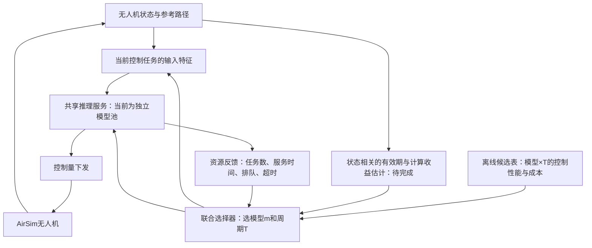

# 当前进度、整体框架与在线资源反馈第一版

## 当前实验已经说明什么

2026-10-04，用户完成同一条路线、同一三机错峰配置下的四模型×三周期试飞。12种配置全部完成穿门和实时验收，零超时。

以下是相同活动参考时间窗口内的三机等权轨迹RMSE，单位m；这是飞机跟踪位置的误差，与训练中的标准化控制输出MSE不同。

| 模型 | T=D=50ms | 75ms | 100ms |
|---|---:|---:|---:|
| plain4x256 | 0.3563 | 0.3752 | 0.3876 |
| plain4x512 | 0.3667 | 0.3735 | 0.3824 |
| plain6x1024 | 0.3684 | 0.3710 | 0.3855 |
| residual21x1024 | 0.3661 | 0.3858 | 0.4047 |

数据来源：`controller_architecture_study/results/dynamic_complexity_237d_v1/joint_model_period_v1/summary.json`。当前观测最佳静态配置是plain4x256、T=50ms。

在这条路线和这些周期下，四个模型的轨迹误差均随T增加而增大；最大模型的离线拟合优势没有体现为更小的闭环误差。每配置仅一次，且residual21x1024/50ms复用先前运行，不能将百分之几的差异解释为统计显著或跨场景优势。它们的实际服务时间也随运行条件波动。

这轮足以推进框架。它支持使用小模型作为强静态对照，还没有证明动态复杂度或超网必需。

## 整体目标与两个反馈回路

目标是在多个控制任务共享计算资源时，依据状态和负载选择模型m与控制周期T，得到更好的实际控制性能。R是实现这一选择后产生的响应时间，受模型、队列、预处理和通信共同影响，并不是任意指定的参数。



下层回路负责每一次控制；上层回路改变后续任务的计算方式和更新频率。超网未来替换共享推理服务中的模型池，选择器、路径规划、反馈记录继续使用相同接口。

| 部分 | 当前情况 |
|---|---|
| 237D特征、DNN控制器、路径规划 | 已有，已实际试飞 |
| 三机共享推理、错峰调度、日志 | 已通过用户实跑 |
| 模型×T静态候选性能表 | 12配置已完成 |
| 资源反馈在线联合选择 | 本次完成代码，用户运行GPU实验 |
| 在线状态条件的T_max及模型收益 | 尚未实现/校准 |
| 飞行中按在线策略切模型和T | 尚未接入；待下述请求实验结果后接入必要场景 |
| 多出口、弹性共享网络 | 尚未实现；作为后续计算后端比较 |

原先的237D数据、模型和仿真控制代码保持原状；本次新增独立模块。

## 本次实现如何决策

入口：`controller_architecture_study.replay_online_joint`；策略：`online_joint_policy.py`。

1. 读取本轮12配置的轨迹误差先验和服务时间，校验报告、模型及数据来源。
2. 四模型同时常驻，由一个FCFS推理工作线程实际执行GPU计算；每个请求源最多一个未完成请求。
3. 请求源数量按3→8→16→32→8→3变化，每阶段6秒。这里是推理请求源数量，不能当作32架无人机实飞。
4. 每秒和负载变化时，根据过去两秒已完成请求更新各模型服务P95、释放抖动和当前待处理工作量。
5. 对候选做资源估计：`N×服务P95/T <= 0.75`，且`抖动P95+待处理工作估计+候选服务P95 <= T`。0.75是可配置的经验余量；这些公式仅为启发式筛选，P95及其加和不是WCET或联合概率保证。
6. 在估计可行候选中选择原试飞轨迹误差最小者。切换至少驻留2秒；原配置估计不可行时可立即调整。恢复到更高质量配置需至少1%的先验收益，以减少抖动。
7. 如果没有估计可行候选，请求实验继续用资源需求最小的配置记录过载，并明确标记不可行。这不是给真实飞机准备的恢复控制策略。

选择器只接收当前负载和已有完成记录，不接收未来负载计划，不读取MPC标签。现阶段的质量先验是固定路线总体指标，尚不能表达“这个飞行状态值得用大模型”。不要据此宣称已经实现状态感知控制。

静态对照使用本轮观测最佳plain4x256/50ms，不刻意选一个弱模型做对照。自适应可以一直选择小模型，也可以只改变T；均按实际发生的结果记录。

## 时间和公平比较口径

- 顺序为固定→自适应、自适应→固定，共两轮四次回放，测量时间144秒，另加载入与预热。
- 输入来自同一验证集的固定逻辑时间序列；两种策略在相同逻辑时刻看到相同源数据。T不同会采到不同子集，因此不直接比较它们各自请求子集的标签MSE。
- 所有候选均为D=T。每条已提交请求的期限保持不变；后来调整T不能使旧超时变成按时。
- 新T从后续释放间隔生效，已安排的下一次释放时间保留。这个过渡规则会被记录；飞行接入时还需与命令保持时间对齐。
- 没赶上的释放和busy丢弃都进入超时分母，超时输出丢弃，已经耗费的计算仍计入。
- 记录各阶段超时率、响应时间、排队时间、模型/T使用次数、选择开销、模型切换和周期切换。
- 同时记录及时输出的数据年龄：平均/最大年龄以及首次有效输出前的未服务比例。该指标使用主机采样时刻，反映信息更新的新鲜程度，不是实际飞机的状态误差。
- 本轮R为计划释放至推理输出返回的时间，不包含AirSim状态RPC、轨迹生成、控制下发和板端通信。不能与三机完整链路R直接等同。
- 这是开放输入序列上的资源反馈回路，没有模拟飞机动力学闭环。报告中的COMPLETE表示回放完成，超时可以非零，不表示飞行/安全通过。

## 一整段运行命令

先关闭AirSim/UE4，停止其他GPU训练和控制程序。此轮不会打开AirSim，也不会训练模型。

```powershell
$proj = 'F:\FalconReproduction\airsim_control'
$trainPy = 'D:\files\PYTHON\cv_lab\Yolov8_Beginner_Demo-main\.venv\Scripts\python.exe'

Set-Location -LiteralPath $proj
Remove-Item Env:PYTHONPATH -ErrorAction SilentlyContinue
if (-not (Test-Path -LiteralPath $trainPy)) { throw 'Python 路径不存在' }

& $trainPy -m controller_architecture_study.replay_online_joint --device cuda --clients 3 8 16 32 8 3 --stage-seconds 6 --rounds 2 --resume

if ($LASTEXITCODE -ne 0) {
    Write-Warning '回放中止，已完成部分保留。请查看输出路径下的报告。'
}
```

结果目录：`F:\FalconReproduction\airsim_control\controller_architecture_study\results\dynamic_complexity_237d_v1\online_joint_pool_v1`。

- `summary.json`：四次回放汇总。
- `round*/attempt_*/report.json`：各负载阶段指标、切换次数、选择开销和数据年龄。
- `decisions.jsonl`：每次选择、原因、当时估计值。
- `requests.jsonl`：每个请求实际模型、周期、自己的期限、状态和输出。

中断后用同一段命令续跑，已完成回放跳过，中断尝试保留并另建attempt重跑。推理/配置异常需先处理。改变模型、输入或代码后使用新输出目录，不与已有结果混合。

## 这轮之后如何推进

先查看固定与自适应在相同动态负载下的超时、更新年龄、队列和切换行为，而不是只看“是否发生切换”。如果固定小模型已足够，保留这个结论。

随后把选择结果接入现有三机实际控制入口，完成一轮必要的动态T/模型切换试飞，检查参考时钟连续性和控制量跳变。状态相关T_max与局部计算收益需要独立推导/校准，不能由本轮请求实验得出。

共享网络应沿用此选择接口和对照口径。只有它在同样的状态/资源条件下带来更好的控制性能、更新及时性或计算复用收益，才能支持其研究价值。
