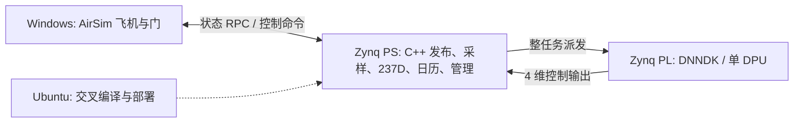

# Route B: Current Framework, Implementation, and Open Issues

更新：2026-11-17。给首次接触本项目的协作者阅读。本文以[修订后的研究规格](OBLIGATION_PROTECTED_BUDGET_FRAMEWORK_20261116.md)为**设计基准**，用板端源码和原始报告描述**当前实际状态**。两者不等同；带日期的旧 Windows 报告也不自动代表当前板端版本。

## 先用一分钟理解项目

我们研究多架无人机共享一块 FPGA/DPU 执行 DNN 控制。每架飞机都要定期获取状态、构造 237 维输入、运行一个 DNN，并把控制命令交给 AirSim。计算资源共享后，某架飞机突然需要更及时或更准确的控制时，给它更多 DPU 时间可能挤占其他飞机。路线 B 想解决的是：**依据当前控制义务和可用时间，低开销地选择模型、执行顺序及未来发布时刻；如有可靠证据，再临时转移一次低风险更新的计算预算，同时保护所有飞机的已承诺更新。**

这首先是实时调度和控制义务分配问题。教师输出 MSE 只是模型质量代理，命令按期返回只是时序观测；二者都不能单独证明飞行安全。路线 A 的 Windows/CPU 分段模拟、旧量化模型和路线 B 的真实板端试验必须分别引用。

**当前运行分工：**控制程序、调度与 DPU 调用在板端 PS/PL；Windows 承载 AirSim 物理仿真。Ubuntu 是构建/交付环境，不在每条控制命令的实时路径中。板端仍通过网络向 Windows AirSim 发 RPC；Linux 普通线程和经验计时包络尚不能给出硬实时 WCET 证明。[PS 迁移复核](PS_MIGRATION_DELIVERY_REVIEW_20261116.md)说明源码和运行身份。

## 研究规格究竟提出什么

1. **先确定一条控制义务的最晚生效时间。** 任务按绝对日历在 $r_j$ 发布，状态在 $s_j$ 采样，输入准备好后才可进入 DPU。有效命令期限要同时满足槽期限、旧控制还能保持的期限、输入新鲜度和最长更新间隔；若跳过一次，还要满足冻结的补更期限。令 $t_x$ 为观测时刻、$u^{old}$ 为正在生效的控制，则物理保持界写成 $d^{hold}=t_x+B(x(t_x),u^{old})$。$B$ 是在所列动力学/误差假设下**旧控制可继续保持的保守时长**，不是新 DNN 输出的安全证明。当前新鲜度默认 80 ms 是工程设置，实际“生效时刻”尚由命令 RPC 返回代理。完整定义见[研究规格第 3～5 节](OBLIGATION_PROTECTED_BUDGET_FRAMEWORK_20261116.md)。
2. **保护已承诺工作后再算当前 DPU 预算。** 对固定的后续顺序、就绪时间、承诺模型成本和设备期限，从后往前算最晚开始时间 $\ell_k=\min(D_{j_k},\ell_{k+1})-p_{j_k}$。当前任务实际可启动于 $e$ 时，可连续占用的预算是 $b_i(e)=\min(D_i,\ell_1)-e$。它只对**给定顺序与成本**成立；经验成本和未来就绪预测下，它只是筛选，不能跳过 PS、通信、全组义务及提交时刻检查。
3. **在预算内选模型，再看全组。** 从已经部署的候选中，优先选满足预算、教师误差较低的模型；模型错误率与物理恢复能力须分开记录。若某架飞机需要更长 DPU 时间，可用 A（发布/输入来得太晚）、B（必要计算量超容量）、C（有实际重排/阻塞可修复证据）来排除无效动作，而不是只按耗时占比猜原因。必要条件剪枝、候选排序、完整全组验证是三层不同判断。
4. **跳一次并限时补更是可选机制。** 它只撤回尚未发布的一个未来控制槽，并把原下一槽变成必须及时交付的补更义务；不能追回已发布任务。节省的时间要扣除补更及管理开销，且旧控制保持资格、模型质量收益和其他 UAV 的影响都要复核。即使原计划可行，理论上也可以在可靠闭环损失数据下比较质量收益；当前没有足够数据批准这种主动交换。
5. **有界决策和原子提交。** 研究规格建议每轮最多 8 份完整日历检查，优先沿用仍有效的承诺；必要时试少量替代执行顺序、模型/未来周期调整或跳更供方。提交前用最新状态、版本、真实时间、全部受影响任务再验一次。已经执行的任务不能在纸面上改期限。分段 DPU 和超网是后续扩展，不能算现有板端能力。

一个直观例子：A 的下一次有效命令还可等 12 ms，后续 B 已承诺占用 5 ms，当前不可抢占工作还剩 2 ms。即使 A 的大模型要 8 ms，也不能仅因“12 ms 内能做完 8 ms”就批准；必须从可启动时间扣去阻塞，给 B 留出 5 ms，再检查 PS 输入、下发及所有期限。若旧控制保持期限先到，模型再快也无法把过去的时间补回来。

## 现在实际上已经跑到哪一步

| 环节 | 当前代码/真实运行 | 与研究规格的差距 |
| --- | --- | --- |
| 端到端控制链 | **已上板并实飞。** PS C++ 定时发布、AirSim 状态/碰撞 RPC、参考与 RAW237、保持分析、本地 DNNDK、命令下发；PL 跑真实 237D INT8 模型。 | 命令返回是生效代理；线程调度、网络/执行器最坏界未认证。 |
| 模型池 | 18 个独立重量化模型已部署；最近容量实验候选 ID 为 5、10、13、8、11，派发时确有选用不同模型。 | “18 个都在板上”不等于 18 个都在线被选；教师 MSE、状态相关恢复资格和闭环收益尚未贯通。超网未部署。 |
| 任务/期限与日历 | 绝对发布、单机在途管理、经验 PS/DPU 成本、有限窗口日历和版本守卫已实现；模型预算和 A/B/C 的早期实现可运行。 | [修订规格](OBLIGATION_PROTECTED_BUDGET_FRAMEWORK_20261116.md)中的完整可信上界、未来义务出口、更新后的 A/B/C 证据语义、所有派发改模后的全组承诺，尚未整体证明或验收。 |
| 管理线程 | 有界检查、最新状态复核和配对状态到达后唤醒已在板端测试；原期限/版本守卫保留。 | 多机负载下经常拿不到全组同一时刻合格的上下文；管理长尾与提交窗口仍有问题。 |
| 周期 $T$ 与顺序 $\sigma$ | 源码存在未来周期/整任务派发修改入口；历史 Windows/较小板端场景出现过周期改变。当前板端按整条 DNN 执行。 | 最新双机与十二机压力轮中**没有实际安装联合新计划**；不能把候选建议、KEEP 安装或派发选模叫做 $T,\sigma$ 联合调整成功。 |
| 跳更、补更 | 有候选/债务状态和反例检查；现有版本宁可拒绝状态不匹配的建议。 | 真实跳过、按期补更、被跳飞机的闭环损失、主动质量交换均**尚未验收**。 |
| DPU 分段/超网 | 路线 A 的 CPU 模拟曾支持段级思想；路线 B 板端是整任务 DNNDK。 | 板端没有已测的子图暂停/恢复、段间切换成本或超网共享前缀，不能宣称有限抢占已经上板。 |

**一句话区分：**板端主控制链已经可用，派发时换模已经发生；最新论文提出的“保护未来义务、按净预算作联合重排/改期/跳更并取得控制质量收益”尚没有完整实证。

## 按证据等级看实验结果

| 证据 | 可以得出的结论 | 不能推出什么 |
| --- | --- | --- |
| [原始 PS 迁移 17 轮复核](PS_MIGRATION_DELIVERY_REVIEW_20261116.md) | 单/双机共 18,004 条请求按期交付；是真实板端 DPU，非 CPU 模拟。 | 该批全用 ID11，0 次换模/改周期/跳更；不证明新联合策略收益。 |
| [control004 双机开/关](PS_PAIRED_TRIGGER_AND_LIVE_TAIL_RESULTS_20261117.md) | 各 1,334/1,334 交付，配对状态唤醒发生 23 次；172 项 ARM 回归通过。 | 23 次提前唤醒中没有实际 $T/c/skip$ 改变；P99 的单次组间差不能作为稳定加速结论。 |
| [异质十二机、2.4 m 净宽、20 ms、32 s 同条件对照](../results/ps_capacity_edge_followup_20261117_002/analysis_w24_pair_001/analysis.json) | 转弯紧迫时间错开；固定与自适应两组均观察到 144/144 门通过、无碰撞；固定交付 **18,964/19,200**，自适应 **19,115/19,200**。DPU 排队 P99 为 **9.795/10.310 ms**，发布到命令返回代理 P99 为 **14.454/15.317 ms**。 | 两组均有丢槽、全部 12 机的严格时序验收为失败；自适应组虽多交付 151 条，但最低采样过门净空 **0.235/0.218 m**（后者更小），12 机平均采样跟踪 RMSE **0.1531/0.1542 m**（后者更大）。不能声称安全或质量胜出。过门仅是采样线段插值，不是连续扫掠体证明。 |
| [十二机规划上下文审计](../results/ps_capacity_edge_followup_20261117_002/paired_coverage_w24.json) | 自适应组 4,466 次管理规划，**0 次联合计划安装**：4,459 次 `obligation_context_not_ready`，7 次 `no_feasible_checked_plan`；开始规划时只有 **8/4,466** 次同时满足“12 机均有匹配状态且无在途命令”这个必要条件。 | 不能把 4,459 次都解释成物理不可恢复，也不能只怪候选算法慢。全组快照门槛过严是当前可检验的原因之一；那 8 次也未必满足保持/期限条件。 |

上述十二机采用冻结异质路线：部分飞机早转、部分中转、部分晚转，其余较平顺；无外加扰动。为了避免原速度下 INT8 输入量程拒绝，保持几何不变而将参考时间放慢到原速度的 0.8 倍；初始净宽 3.8 m 逐步收紧到 2.4 m。低负载四机、七机 50 ms 基本按期，十二机 20 ms 才显著出现 DPU 排队。几何和分析在本地 `controller_architecture_study/results/ps_capacity_edge_followup_20261117_003/` 与 `..._002/`；生成/运行入口在 [`ps_planner_repair/`](../ps_planner_repair/) 中。这里的“fixed”是固定 T20/模型 ID11 的**诊断基线**，还不是在同一任务上选出全局 $J$ 最高的 FALCON 式静态配置。

一次反向顺序自适应复跑在约 17 s 出现 `executor_failure`，报错合并了 DPU payload registry 的几种情况，根因未定。随后只增强错误信息的跟踪版通过了 ARM 回归并完成另一次 32 s 飞行；这不等于间歇故障已修复。不要丢弃失败记录，也不要只挑成功复跑报告。

## 当前真正阻碍论文结论的事

1. **联合调整尚未落地。** 十二机确有资源争用，但管理规划大多拿不到全组配对快照，实际 $T/\sigma/skip$ 安装为 0。需要按受影响任务的版本与残余义务判断，而不是机械要求所有 12 机同一时刻完全空闲；任何放宽都须保留已经发布/在途工作的全组验证。PS 日历是否把本可并行的各机前端工作过度串行计费，也要用时间戳审计，现阶段只是待验证假设。
2. **硬期限与物理资格尚无完整保证。** 十二机两组全部时序失败，证明当前负载点不能写成硬实时成功；经验 P99/最大值不是 WCET。$B(x,u^{old})$ 依赖动力学与误差假设，当前没有覆盖全部实际状态的可靠恢复资格，RPC 返回也不是电机生效时刻。
3. **收益链还未闭合。** 板端有模型时间/教师 MSE 差别，但尚未证明“跳一次低风险更新 → 扣除补更后净预算变多 → 更好模型闭环质量提升且供方损失更小”。转弯初期/末期漏更影响不同的旧 AirSim 实验是动机，不能直接替代一次主动跳更资格。
4. **运行稳定性待定位。** 管理线程曾出现 9.150 ms 的单次诊断 CPU 离群值；同输入在同板离线重放约 0.169 ms，未证明具体并发根因。[现场定位](PS_PAIRED_TRIGGER_AND_LIVE_TAIL_RESULTS_20261117.md)。十二机的间歇 executor 故障也需利用跟踪版捕获首个明确错误。
5. **公平基线/重复性不足。** 当前十二机只有一组有效固定/自适应配对，固定配置不是离线最优。需要同一模型池、资源、路线、初态、门宽下先选静态配置，再做多次配对，并报告失败、丢槽、期限、最小净空及全程质量，不能只看是否穿门。

## 建议下一轮怎么接

- **先固定容量边界。** 在已冻结的 2.4 m、0.8 倍速度路线下，优先复核十机 20 ms 或十二机 30 ms 等“部分配置可能可行”的边界；保留十二机 20 ms 作为过载反例。每次保存版本、模型 ID、任务状态、DPU 队列、管理/提交时间和逐机结果。
- **再修管理提交。** 用已有 [全组快照覆盖审计](../results/ps_capacity_edge_followup_20261117_002/paired_coverage_w24.json) 建立反例：正在运行的任务、未配对观测和未来可改义务要分别处理。做 ARM 生命周期/调度回归后，只在板端短试飞检查是否真的安装改模、改期或重排；保持版本 CAS 和绝对提交界。
- **最后谈控制收益。** 为同一状态、同一生效时间的候选模型和单次跳更/补更收集闭环损失，先影子筛选再有限接管。用真正离线选出的最优静态配置和相同检查预算比较；若找不到净预算跨越有意义模型档位的状态，就收窄论文主张，不强行保留跳更或分段。

完成每步都应分别写“代码通过检查”“真实板端任务按期”“实际新配置安装”“物理结果改善”。这四句话不能互相替代。

## 阅读与协作入口

- 研究动机、公式、伪代码及待验证假设：[修订 Framework](OBLIGATION_PROTECTED_BUDGET_FRAMEWORK_20261116.md)。这是**研究规格**。
- 真实 PS 迁移身份与旧单/双机数据：[迁移交付复核](PS_MIGRATION_DELIVERY_REVIEW_20261116.md)。最新管理实现/计时：[control003](PS_MANAGEMENT_REVALIDATION_RESULTS_20261117.md)、[control004](PS_PAIRED_TRIGGER_AND_LIVE_TAIL_RESULTS_20261117.md)。
- **可在 GitHub 获取的完整 PS 源码：**[冻结诊断版与依赖说明](../ps_board_source/README.md)，主入口、日历、237D 构造、AirSim RPC、真实 DPU 接口、构建脚本及逐文件哈希均在 `../ps_board_source/20261117_executor_trace/`。这是最新十二机调查时的异常诊断版本；可维护的局部修复脚本另见[ps_planner_repair/README.md](../ps_planner_repair/README.md)。冻结快照只做新版本复制，不覆盖旧版。
- **GitHub 可见性：** 提交 `ps_board_source/` 后，协作者可直接读到上述完整 PS 源码；`controller_architecture_study/results/` 仍被 `.gitignore` 排除，本文件里的原始分析链接在只克隆 GitHub 的机器上不可用。模型 ELF、SDK、AirSim/rpclib 库及原始日志仍需按[源码交付说明](../ps_board_source/README.md)另行提供。源码可见不等于克隆后可独立构建/复现实测，也不等于已修复间歇 executor 故障。
- 开始修改时先在 [`docs/COLLABORATION_STATUS.md`](../../docs/COLLABORATION_STATUS.md) 认领并写明文件，结束时补结果、证据和未解决项。同一文件多人同时修改先协调。优先更新本状态文档和索引；历史报告保留原结论。
