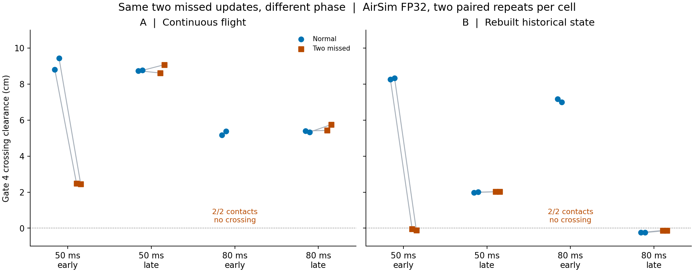

# 路线 B Framework｜多机共享 DPU 的相位感知控制调度

2026-11-15 · 当前整合设计及验证进度

**让多架无人机共用一块 DPU。当某架飞机即将需要纠偏时，提前为它留出推理时间。其他飞机可以换一个更快的合格模型、推迟后续更新，或在允许的情况下跳过一次并按时补更。** 当前设计的重点是让这些选择可解释，并在改动前检查其他飞机的控制期限。

## 1. 系统到底在调什么

每架飞机按控制日历发布任务，采集状态并构建 237D 输入。CPU（PS）负责采样、输入处理、决策和控制下发，FPGA（PL）上的 DPU 执行模型推理。多架飞机的任务可以同时处于不同环节，但此处按**单个 DPU 串行执行整模型**设计。一个模型已经开始执行时，它会占住 DPU 直到结束。

| 决策 | 改的是什么 | 什么时候有用 |
| --- | --- | --- |
| $T$ 与释放时刻 | 以后隔多久发布任务，或把下一次尚未发布的任务提前 | 让关键更新更早进入流水线，或减少低风险阶段的未来负载 |
| $c$，DNN 档位 | 派发时选择哪个已验证合格的模型 | 资源紧张时缩短设备占用，时间充足时提高控制输出保真度 |
| $\sigma$，派发策略 | DPU 空闲时先跑谁、跑哪档、是否等待 | 防止一个长推理堵住马上要准备好的关键更新 |
| 计划跳过 | 取消一个仍可撤回的发布槽，并登记下一次强制补更 | 经过验证的低风险阶段，且补更能兑现时，用于临时减载 |

~~~mermaid
flowchart TD
    A["观测无人机状态、正在作用的命令和路线进度"] --> B["计算命令生效期限，识别必须保护的更新"]
    B --> C["汇总各机发布日历、PS 进度、合格模型和补更"]
    C --> D["DPU 空闲时，反推本次最多可连续占用多久"]
    D --> E{"找到能装入时间预算的合格任务与模型？"}
    E -->|"有"| F["按保留的后续顺序派发，跟踪命令实际生效"]
    E -->|"输入即将就绪，等待仍可行"| G["暂等受保护更新，收到就绪事件后重算"]
    E -->|"现有计划不可行"| H["A／B／C 诊断，调整未锁定的配置"]
    H --> I["核对全部回路、补更与剩余工作，确认版本后提交"]
    I --> C
    F --> A
    G --> D
~~~

## 2. 先决定哪条命令最晚必须生效

把一次控制任务看成从**计划发布**到**新命令真正生效**的一条链。其总响应时间为 $R_{ik}=a_{ik}-r_{ik}$，其中 $r_{ik}$ 是第 $i$ 架飞机第 $k$ 次更新的计划发布时间，$a_{ik}$ 是新命令生效的时刻。

~~~text
发布 r ── 采样和输入处理 ── 等待 DPU ── 推理 ── 下发 ── 生效 a
         └──────────────────── 响应时间 R ────────────────────┘
~~~

每条正常更新有三道时限。取三者中最早的作为新命令的绝对生效期限。

$$
d^{\rm act}_{ik}=\min\{r_{ik}+T_i,\ d_i^{\rm hold},\ d_{ik}^{\rm fresh}\}.
$$

$r_{ik}+T_i$ 约束该任务在周期内完成，周期正在切换时使用已经提交的下一释放边界。$d_i^{\rm hold}$ 表示上一条命令最多能保持到什么时候。$d_{ik}^{\rm fresh}$ 表示该次采样信息最晚什么时候还能用于控制。准入要求 $a_{ik}\le d^{\rm act}_{ik}$。较早的 DPU 结果仍需给下发留时间，派发用的设备期限因此是

$$
d_{ik}^{\rm DPU}=d_{ik}^{\rm act}-L_{ik}^{\rm post,ub},
$$

其中 $L_{ik}^{\rm post,ub}$ 是从 DPU 结束到命令生效的路径上界。若本轮旧控制保持预算 $B_i$ 从观测时刻 $t_x$ 算起，则可用 $t_x+B_i$ 得到对应的绝对时限，前提是观测与正在作用的命令匹配。工程回放可以使用经验预算，物理保证则依赖已验证的保持界和系统时序上界。

## 3. 为什么转弯相位会改变任务优先程度

在已有的一条 AirSim 路线上，同一 FP32 模型分别在转弯早期和晚期连续漏两条更新。**50 ms 周期**下，连续飞行的早期组净空从约 **8.8–9.4 cm** 降到 **2.4–2.5 cm**，晚期变化为毫米级。**80 ms 周期**下，早期干预四次均接触左门框，晚期无接触。早期正处在建立纠偏动作的阶段，继续保持旧命令的代价更大。

图中蓝点为正常更新，橙点为漏两条，连线对应一次配对。标注“接触、未穿门”的组无法得到穿过门平面时的净空。该结果用于提出相位假设，具体到其他弯道时，应根据路线进度、横向误差与速度、当前命令和参考转向变化核验。[实验条件与原图解读](ROUTE_B_GROUP_MEETING_20261110.md)

**相位决定某条更新能否撤回。** 若正在建立纠偏、保持期间可能进入敏感阶段，或者状态超出验证覆盖，就保护这条更新。已验证可以保持的状态下，才允许跳过一个可撤回的槽，并把下一条更新登记为强制补更。设 $j^+$ 是补更，所需条件之一为

$$
\widehat a_{j^+}\le
\min\{d_j^{\rm hold},\ d_{j^+}^{\rm fresh},\ r_{j^+}+T_j\}.
$$

还要通过其余回路的时序检查，并且同一回路在补更前不能再跳。比如旧命令只能保持到 **110 ms**，跳过 **50 ms** 的更新会让下一条在 **120 ms** 生效，这个方案即使能腾出算力也会被拒绝。计划跳过和意外超期在日志中分别计数。现有飞行证据来自**连续漏两条**，具体到**主动跳一条并限时补更**的效果仍要验证。

## 4. 核心调度策略是反推本次 DPU 占用上限

当 DPU 空闲时，队列里可能已有一个长模型准备好，而更紧急的更新还在 CPU 构建输入。调度器先看**接下来已经承诺交付的控制任务**，包括尚在前处理的受保护更新和强制补更。沿一条已检查的后续 DPU 顺序，反推每个任务的最迟开始时间。

设后续任务为 $j_1,\ldots,j_n$，它的输入可交给 DPU 的预计上界为 $q_j$，合格保底模型的设备占用上界为 $p_j$。从队尾往前计算

$$
\ell_{n+1}=+\infty,\qquad
\ell_k=\min(d_{j_k}^{\rm DPU},\ell_{k+1})-p_{j_k}.
$$

只要有 $q_{j_k}>\ell_k$，这条后续顺序在当前预算下就无法兑现。否则，在时刻 $t$ 先执行已就绪任务 $i$ 时，把它从后续队列取出，它本次最多能占用

$$
b_i(t)=\min\{d_i^{\rm DPU},\ell_1\}-t.
$$

随后从当前状态和时延下经闭环验证的模型集合 $\mathcal A_i$ 中，选择占用能装入预算、误差代理值最低的档位。

$$
c_i^*=\arg\min_{c\in\mathcal A_i,\ C_i(c)\le b_i(t)}E_i(c).
$$

$C_i(c)$ 要计入相关的 DPU 占用和切换代价。$E_i(c)$ 可先用同样本下相对教师的标准化误差来排序，模型是否够用由闭环资格决定。若当前任务的最快合格档也塞不进去，尝试其他 ready 任务，或在已验证可行时等关键任务就绪。倒推判据针对固定尾序列和给定时序输入。PS 并发、同机工作槽、输入有效性与计划切换仍由全组检查处理。

### 手算一遍

现在是 0 ms。普通更新 A 已 ready，自身 DPU 期限是 10 ms，可以选 **5、3.2 或 2 ms** 的合格模型。B 是转弯中的关键更新，C 是之前承诺的补更。

| 任务 | DPU 就绪 | DPU 最迟结束 | 合格保底耗时 | 倒推最迟开始 |
| --- | ---: | ---: | ---: | ---: |
| B，早弯关键更新 | 2.5 ms | 5.5 ms | 2 ms | **3 ms** |
| C，强制补更 | 4 ms | 7 ms | 2 ms | **5 ms** |

先算 C，最迟在 $7-2=5$ ms 开始。B 必须在 C 开始前交出 DPU，因此最迟在 $\min(5.5,5)-2=3$ ms 开始。A 的占用上限是 **3 ms**。

~~~text
选 A 的 3.2 ms 档   A [0–3.2] → B [3.2–5.2] → C [5.2–7.2]  C 迟 0.2 ms
选 A 的 2.0 ms 档   A [0–2.0] → 等至 2.5    → B [2.5–4.5] → C [4.5–6.5]
~~~

这比只保护最近一条更新多看到了一层约束。**只保护 B 时，A 用 3.2 ms 也能让 B 按时，但会拖过 C 的补更期限。** 完整规则允许 A 先用 2 ms 档，把设备空档用起来，同时保住 B 和 C。[派发判据与推导](ROUTE_B_DPU_DISPATCH_20261114.md)

## 5. A／B／C 负责修复失效计划

普通派发沿用已验证的短窗口计划。若输入进度变化、期限收紧或模型无预算可用，才进入较贵的联合修复。它按失效原因缩小搜索范围。

| 类型 | 怎么识别 | 优先试什么 |
| --- | --- | --- |
| **A · 单条控制链来不及** | 最乐观的独占执行路径仍会错过期限 | 提前尚未发布的任务，或选更快的合格模型。如果立即开始仍赶不上，记录反应过晚 |
| **B · 期限前容量不足** | 在某个 PS 或 DPU 窗口内，必须做完的工作量下界超过供给 | 减少该窗口的实际工作量。换轻模型、调整未来释放节奏，或对通过相位与补更检查的任务临时减载 |
| **C · 当前顺序造成等待** | A、B 的检查未发现超量，当前派发仍导致迟到 | 追踪实际阻塞者，尝试重新安排尚未执行的任务、调整占用档位或为即将到达的任务留空 |

例如 A 类在给定模型下的时间条件为 $r_i\le d_i^{\rm act}-L_i^{\rm solo}$。$L_i^{\rm solo}$ 是独占情况下从释放到命令生效的剩余链路时间。用可信下界发现仍会迟到时，单纯重排无法修复。C 类由反事实回放判断是否真的存在可行顺序。候选通过所有回路的检查，且快照、命令版本和日历还有效时，才原子提交。已经运行的工作仍按剩余成本计入。[A／B／C 公式及回放](ROUTE_B_PHASE_AWARE_FRAMEWORK_20261114.md)

## 6. 学术主张与当前证据

RICH 的 MRAF 以剩余加速段数选择任务。路线 B 的整任务 DPU 上，能改变的是**一次派发所承诺的连续占用时间**。本课题要验证的主张是：**另一架飞机的路线相位、CPU 进度和补更期限，会改变当前任务可以使用的模型档位。** 倒推与动态预算各有先例，最有区分力的实验是给基线相同模型池、相同前瞻窗口和切换能力，让它只保护最近一条关键义务，再比较完整尾序列是否减少关键更新迟到、保持闭环质量。[相关工作与强基线](ROUTE_B_DPU_DISPATCH_20261114.md#4-哪一点有机会成为论文贡献)

| 已有证据 | 当前结论及适用范围 |
| --- | --- |
| FP32 AirSim 早／晚干预配对 | 一条路线存在明显的漏更相位差异。独立路线和新 INT8 的单次跳过效果待测 |
| 旧版 18 档板端计时、Ubuntu 新 PTQ 的六档误差摘要 | 可用于反事实回放。新误差来自候选选择集，独立验证和新真板计时待测 |
| 480 个合成场景 | 固定配置 55 个通过联合检查，A／B／C 无跳过 325 个，加入相位及补更规则 326 个。把预留从 0.5 ms 改到 8 ms 并锁住已发布任务后，后者为 29 个 |
| 50,000 组固定顺序核对 | 倒推判据与逐任务前推一致。完整派发策略的全队列收益和板端闭环待验证 |

480 场景对应此前 A／B／C 与跳过的回放，表格里的通过数不能作为新派发规则的效果。结果表明，当前最该测的是**倒推派发能否在关键任务发布前完成，且在相同候选模型和相同决策预算下，比前瞻 EDF 少漏关键更新**。后续用新 INT8 的板端时序和闭环资格替换假设，主要报告关键更新迟到、补更超期、最小净空、资源空等和决策开销。[回放证据与边界](ROUTE_B_PHASE_AWARE_FRAMEWORK_20261114.md)
