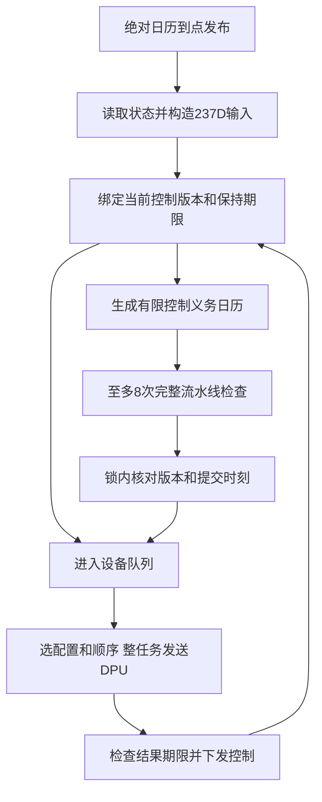

# 路线 B：release001 实时框架接入与实飞记录

2026-11-16。本文说明最新实现，区分机制已经接通、实际飞过、研究收益已经成立三种状态。此前的[离线实现报告](ROUTE_B_RELEASE001_IMPLEMENTATION_20261116.md)保留当时的结果。

## 一、这次完成了什么

原来新的调度核心只在离线日历中运行。这次将它接进真实控制链：Windows 采样和决策，经 UDP 向 Zynq 发送原始 237D 输入，由 DPU 返回四维物理控制量，再交给 AirSim。没有用 CPU 推理冒充板端，没有改变归一化或裁剪越界输入。

使用 Ubuntu 的 `board_package_requant18_release001`，端口 5239，wire tag 为 `9253dd1fc87f8d7f`。18 个模型各一条黄金输入均取得有效回复；飞行入口另外核对初始模型及所选候选的黄金输出。

| 步骤 | 当前程序做什么 | 当前证据和边界 |
| --- | --- | --- |
| 读取配置池 | 校验交付身份，读取每档服务成本和 TRAIN512 评分 | 18 档 profile 可用；不使用共同480条核对组来在线选模 |
| 释放任务 | 按绝对日历发布；任务忙碌或过期有独立丢弃记录 | 新入口使用 Python 日历和 RPC；旧 C++ 入口保留 |
| 分析状态 | 绑定当前状态、已生效控制版本，计算保持期限 | 沿用现有保持分析器，参数仍是开发假设，尚无严格物理证书 |
| 建立控制义务 | 汇总在途工作、当前不可抢占请求，以及每机两个未来槽 | 有限滚动窗口；不是无限未来的可调度性证明 |
| 提出和检查修改 | 当前 EDF → 快模型 → 有限重排 → 改未来释放 → 有条件跳过；通过后尝试一次质量升级 | 每次最多8次完整 PS/PL 检查、12个候选；不是任意组合的全局最优 |
| 安装修改 | 日历锁内核对版本和真实提交时刻，再安装配置、释放及派发顺序 | 拒绝旧快照和超时决策；已发布任务不改释放时刻 |
| 实际执行 | 一个整任务占用板端；请求完成后才能换下一个 | 已完成真实模型切换；没有实现 DPU 内部分段抢占 |
| 跳过和补更 | 仅撤回未发布槽；保留原周期，把紧邻下一槽登记为必须完成的补更 | 状态机和针对性检查通过；本批真实飞行没有触发，尚无实飞收益证据 |



## 二、时间、模型和跳过分别怎么决定

对一条已经采样的任务，实际执行检查使用：

\[
d^{act}=\min\{r+T,\ d^{hold},\ s+F,\ d^{recovery}\}.
\]

这里 `r+T` 是发布时冻结的周期期限；`d_hold` 来自当前已施加控制及观测的保持分析；`s` 是本次采样开始时刻，`F` 默认80 ms；最后一项仅在欠补更时存在。新控制必须在这个界限前下发并取得命令返回代理。它不是直接测到的电机生效时间。

未来日历使用采样/前处理、DPU服务、命令下发的经验成本。成本取历史观测上界并随实测增大；每档初始服务包络另加3 ms网络余量。3 ms、80 ms和5 ms决策预留都是工程设置，尚不能称为认证 WCET。新模式的输入、输出资格也没有因为 MSE 较好而自动成为恢复安全证明。

调度器从 EDF 尾序列反推连续设备预算。倒推只用于提出候选，最终还必须通过共享 PS、整任务 DPU、每机工作槽的完整前推检查。已在执行的板端任务保留其不可抢占剩余占用；如果它已经超过经验服务包络，本次不再声称能估计剩余时间，等待新上下文。

对可容纳的档位，质量升级选择 TRAIN512 误差最小的一档；当前模型仍可行时不必无条件变小。当前候选集合是显式传入的探索池，**尚未完成随状态变化的恢复合格集合**。所以这里的“可容纳”和“评分较好”，不能直接写成“物理安全合格且最优”。

周期只修改尚未发布的下一槽，并同步修改供本次检查使用的后继槽。不会把旧任务的期限重新往后推，也不会用任务完成时刻重新定义周期。

计划跳过默认关闭，需显式启用。当前探索资格要求位置误差小于0.15 m、未来前六个参考点的速度向量变化小于0.3 m/s、证据新鲜且控制版本一致，同时保持分析必须覆盖整个延后区间。这些阈值是可运行的开发门槛，并非已经由新 INT8 闭环实验验证的相位安全分类器。

跳过后周期不变；紧邻下一槽成为补更，其期限不能通过后续规划放宽。欠补更时不允许再跳。补更允许重新选模型，但须保留期限并重新检查整组。只有按期返回的控制命令才能消除欠账；迟到或失败不能清除。

## 三、实际飞行结果

先从原来的静止起点运行双机固定模型。ID11 两机均因输入量程退出；换成 ID8 同样退出。原始输入第7项约1.00，按当前比例16量化后约128～129，板端返回 `status=3`。这些不是碰撞，也不是调度修复失败；它们说明新版本的输入覆盖仍有限。

为继续验证调度与真实换模，另设明确标注的**参考匹配飞行初态**：在参考时间1.5 s处初始化位置、姿态和参考速度，时间在第一个门之前，之后仍实际飞过全部门。没有注入扰动，静态和动态使用相同初态。这个诊断不能代替静止起飞验收。

默认第二条路线仍会在飞行中出现第25项量程拒绝，因此后续接入对照固定采用环境48/路线0和环境50/路线4，门宽4 m，T=50 ms，20 s。选择这两条路线是为了完成运行链验证，不能据此声称对困难环境普遍有效。冻结路线见[case.json](../results/release001_live_case_20261116/case.json)。

| 接入试验 | 门与物理检查 | 控制交付 | 实际模型请求 | 响应时间P99 |
| --- | --- | --- | --- | ---: |
| 单机动态，从 ID6 开始 | 5/5门，零碰撞，通过身体净空检查 | 400/400按期 | ID6×5、ID11×361、ID8×34 | 18.20 ms |
| 双机固定 ID6 | 两机各5/5门，零碰撞，通过身体净空检查 | 800/800按期 | ID6×800 | 29.14 ms |
| 相同双机、动态选模 | 两机各5/5门，零碰撞，通过身体净空检查 | 799交付、1条在入板前丢弃 | ID6×9、ID11×789、ID5×1 | 20.79 ms |

板端 `switched` 标记与相邻实际请求的模型变化一致：单机40次，双机动态3次。`configuration_updates` 是未来计划修改条目，不能拿它代替真实换模次数。

单机决策平均0.271 ms、P99 0.569 ms，最大观测28.09 ms；双机平均0.401 ms、P99 0.740 ms，最大52.22 ms。单机长决策因超出提交预算拒绝，双机相应长决策因上下文变化拒绝。它们说明“候选数量有界”不等于 Windows 墙钟耗时有严格上界。

双机那条失败的实际过程是：任务晚发布约37.33 ms，约37.65 ms后开始采样；准备好输入时已用掉约45.80 ms。剩余预算不足以覆盖服务和命令下发，因此程序在设备派发处拒绝该任务。它没有 `board_start_s`，并未发给 DPU。日志的 `dropped_inference` 表示等待推理的阶段结束，不能据此判断 DPU 推理超时。同期有一条52.22 ms的规划墙钟记录，但没有内核证据来把全部延迟归因于某个线程或操作系统。

这批三轮的已下发命令均未超过各自 `actuation_deadline_s`，所有仿真/墙钟比例检查通过。但是双机动态存在一次丢弃，故整轮 `timing_passed=False`；没有用“零碰撞”掩盖它。

**这批尚未触发周期修改和计划跳过，也未证明动态提高了安全性或总体J。** 固定 ID6 是接入对照，不是离线全局J最优的 FALCON 基线。参考匹配初态尚未接入原独立J评价器，因此不做总J优劣结论。身体净空很宽裕，这批不承担“静态碰撞、动态救回”的研究验证。

原始结果：[单机](../results/release001_obligation_switch1_20261116_02/result.json)、[双机固定](../results/release001_obligation_samecase_fixed2_20261116_01/result.json)、[双机动态](../results/release001_obligation_switch2_20261116_01/result.json)。[只读派生汇总](../results/release001_framework_audit_20261116/summary.json)记录原报告哈希、实际换模和失败阶段，没有改写原报告。

## 四、今后替换成超网时改哪里

新增 [controller_backend.py](../controller_backend.py)，把控制器表示成配置：配置键、模型族、执行标识以及可选的深度/宽度参数。调度器只需要每个配置的服务成本、资格和评分，以及 `infer(key, raw237)`。

现在的适配器把配置键映射到板端独立模型ID。未来可以用超网适配器把同一个键映射为 subnet 配置，再接实际推理协议。针对性检查已经验证运行时可以接收非1～18的配置键。

**当前尚没有超网权重、超网 UDP 协议、超网板端执行或分段恢复实现。** 换成超网后，仍需重新测子网成本、切换行为、量化身份、输入范围和闭环能力，不能沿用独立模型的代价表就宣布兼容。

## 五、运行与阅读入口

先在板端保持现有5239服务运行，在 Windows 打开 Blocks 并点击 Play。打开命令：

```powershell
& 'E:\epicGamesStrg\UE_4.27\Engine\Binaries\Win64\UE4Editor.exe' `
  'F:\Airsim\AirSim\Unreal\Environments\Blocks\Blocks.uproject' `
  '/Game/FalconEmpty' `
  '-settings=F:\FalconReproduction\airsim_control\controller_architecture_study\configs\airsim_safety_12.json'
```

复跑本次双机动态接入条件，使用已冻结的路线文件：

```powershell
powershell.exe -NoProfile -ExecutionPolicy Bypass -File `
  'F:\FalconReproduction\airsim_control\controller_architecture_study\run_release001_framework.ps1' `
  -Policy adaptive -ModelId 6 -ReferenceStartSeconds 1.5 -AdaptationDelayMs 200 `
  -Case 'F:\FalconReproduction\airsim_control\controller_architecture_study\results\release001_live_case_20261116\case.json'
```

将 `-Policy adaptive` 改成 `-Policy fixed` 得到固定 ID6 对照；每次写入新结果目录。默认不启用探索性的计划跳过。脚本默认参考起点仍是0，直接使用默认值可能复现原静止起飞量程拒绝。

源码阅读：配置与成本 [requant18_profile.py](../requant18_profile.py) → 有限日历 [obligation_scheduler.py](../obligation_scheduler.py) → 实时状态适配 [ip37_obligation_runtime.py](../ip37_obligation_runtime.py) → 实际控制入口 [fly_ip37_joint.py](../fly_ip37_joint.py)。

本轮最终87项针对性新旧检查通过，覆盖固定模型剩余预算、已发布补更、后继改期、提前采样后的输入有效期、旧快照、丢弃与模型派发等；PowerShell脚本语法和差异空白检查通过。测试中的模拟RPC日志不属于额外实飞。

## 六、剩余工作与下一步

1. **部署输入覆盖**：先将[三条真实拒绝输入](../results/release001_framework_audit_20261116/inputs_for_ubuntu.json)交给 Ubuntu 复现，覆盖静止起飞第7项和飞行中第25项。保留新旧候选及独立验证，不在 Windows 改缩放掩盖拒绝。
2. **新版本的恢复资格**：对实际候选建立含接管等待的状态资格，才能把探索候选池替换为已验证的合格集合。训练内平均 MSE 不能替代它。
3. **计划跳过的闭环验证**：冻结单次跳过、早弯保护和按期补更的等时延配对；目前只有离线和状态机证据。
4. **执行尾延迟**：针对晚发布、输入准备和规划的调度时间拆分继续测；目前不能保证 Windows 每次都满足发布/响应上界。
5. **研究对照**：上述基本范围确定后，固定任务规则，重新选离线静态J最优配置，再进行多种负载和路线的动态配对。当前接入对照不能替代该实验。

最新框架已能真正执行选模和有限日历调度，但严格物理资格、计划跳过收益、困难场景总体优势和超网部署仍未完成。
