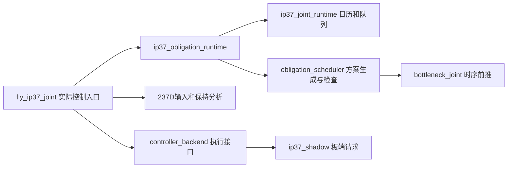

# 路线 B 精简源码：先读哪些文件，哪些暂时不用读

后续纠正：本文对应旧入口的导入兼容包，仍包含不必在PS执行的模块。当前板端移植请优先使用[按PS职责裁剪的源码](PS_SCOPE_SOURCE_AUDIT_20261116.md)，不要把下面全部兼容文件搬到板端。

2026-11-16。针对当前 release001 / `--scheduler obligation`。原工程、模型和历史失败记录保留。本次新增一个只含源码、小型配置、数值fixture的精简副本，便于阅读与协作。

## 1. 先分清四类东西

| 分类 | 用途 | 在精简源码包中 |
| --- | --- | --- |
| 当前控制/调度源码 | 理解和修改框架 | 保留，区分核心与辅助 |
| 测试、配置、小型fixture | 验证改动与移植的一致性 | 保留 |
| 模型ELF、板端可执行文件、大CSV、全量黄金/验证输入 | 部署及完整证据核对 | 单独引用，包中不重复带 |
| AirSim第三方SDK、旧训练权重和大量历史实验 | 外部依赖或历史研究 | 不随源码包重复带 |

源码包不是一个新的算法版本，也不是已移植到PS的程序。纯调度测试可以独立运行；实飞仍需安装参考环境并提供正确版本的模型部署与实测资料。不要删除身份/哈希检查来绕过缺失依赖。

## 2. 第一遍只读这7个核心文件

这些路径都在 `controller_architecture_study/` 下，精简包中保持原相对位置：

| 顺序 | 文件 | 用简单的话解释 |
| --- | --- | --- |
| 1 | `obligation_scheduler.py` | 算法入口：保留哪些控制任务，何时执行，用哪个模型；候选必须经过整组检查 |
| 2 | `bottleneck_joint.py` | 时序计算器：模拟CPU准备、DPU执行和CPU下发，找出谁来不及 |
| 3 | `ip37_obligation_runtime.py` | 把真实队列、控制版本、未来周期、模型选择和补更义务接到算法上 |
| 4 | `ip37_joint_runtime.py` | 运行时基础：周期发布、每机工作槽、队列、完成事件、锁和版本号 |
| 5 | `controller_backend.py` | 配置与执行接口：当前是独立模型，未来可接subnet；本身不实现超网 |
| 6 | `requant18_profile.py` | 读取并核对模型身份、计算成本和评分；定义模型数据结构 |
| 7 | `bottleneck_abc.py` | 基础运行时所用的A/B/C诊断与旧修复接口；新有限日历入口在第1个文件 |

不必从整个目录的第一个文件开始读，也不必先读训练或量化脚本。



## 3. 第二遍看实际飞行链，不急着看历史代码

| 文件 | 职责 |
| --- | --- |
| `controller_architecture_study/fly_ip37_joint.py` | 完整入口、每机控制线程、采样/下发/记录和参数；读 `run`、`Pilot.run_job`、`serve_board`、`plan_live` |
| `controller_architecture_study/fast_convex_preprocess.py` | 参考窗口和原始237D输入 |
| `controller_architecture_study/held_control_safety.py` | 给定当前状态和实际保持的控制，估计剩余保持预算；仍依赖未认证的开发界限 |
| `controller_architecture_study/ip37_shadow.py` | 核对部署身份，加载协议客户端，记录有效回复/拒绝输入 |
| 根目录 `airsim_interface.py`、`control_adapter.py` | 读取AirSim状态、坐标和角速度符号、推力转油门 |
| 根目录 `config.py`、`mpc_controller.py`、`state_adapter.py` | 油门配置、参考数据类型、四元数与状态工具 |
| 根目录 `environment.py`、`gate_route.py`、`gate_visualization.py` | 门的几何与场景辅助 |

`mpc_controller.py` 出现在依赖中，不意味着真实板端DNN控制时每轮都求解MPC；这里也承载了参考数据类型。类似地，出现训练文件名不等于当前执行了训练。

## 4. 为什么包里仍会有一些旧文件

当前入口还从旧脚本借用 `StoredRoutePlanner`、冻结路线加载、指标、模型类型等辅助函数。Python导入时又会导入它们的依赖，因此不能只留7个核心文件就声称完整入口可用。

这次做法是：保留静态导入依赖，明确标记为 `import_compatibility`；不让读者误以为它们都是新的算法模块。包根目录 `FILE_MAP.json` 列出逐文件用途、大小和静态导入模块，`DEPENDENCIES.md` 解释外部依赖。

这些文件是**暂时不用读**，不是已经证明可以直接删除。删除前需要把仍在使用的小函数/数据类型移到清晰的公共模块，再做数值和运行回归；本次没有开展大范围重构。

本次只对 `controller_backend.py` 做了直接相关的小调整：将协议推理模块延迟到实际 `infer()` 时导入。这样配置类型和纯调度测试不再因该接口导入历史Torch链；实际飞行入口仍可能通过其他历史导入依赖Torch。

## 5. 解压后先运行什么

源码包根目录包含 `project/`、`fixtures/`、模型身份引用和逐文件清单。先核对：

```bash
python3 project/controller_architecture_study/ps_migration/verify_bundle.py
cd project

# 仅调度/状态机，Python标准库即可；-S禁止加载第三方site包
python3 -S -m unittest discover -s tests -p 'test_obligation_scheduler.py'
python3 -S -m unittest discover -s tests -p 'test_ip37_obligation_runtime.py'
python3 -S -m unittest discover -s tests -p 'test_bottleneck_joint.py'
python3 -S -m unittest discover -s tests -p 'test_remaining_chain.py'

# 有NumPy后核对输入、控制转换和冻结调度结果；不会连接板子/AirSim
python3 -m controller_architecture_study.ps_migration.check_fixtures
```

Ubuntu参考源码使用Python≥3.11。不要据此要求升级板端系统Python，板端运行链迁移仍见单独的PS交接任务。

完整旧集成/教师参考测试需要现成的NumPy、SciPy、Torch环境，教师对照还需要OSQP1.0.5。它们属于参考验证，不是PS最终运行时依赖要求。纯调度检查通过，也不等于物理安全或真实硬期限已证明。

## 6. 模型和大文件怎么关联

包内 `EXTERNAL_ASSETS.json` 保存同一版本身份以及缺少时应去哪里找。`asset_references/` 放归一化、registry和冻结身份的小文件作为核对参考，**不是一个可部署的缩减模型包**。`fixtures/profile_snapshot.json` 为离线阅读/数值核对而导出，不能替代生产入口的原始证据核验。

实飞时，将 `--bundle` 指向已有 `board_package_requant18_release001`，`--delivery` 指向含该包、`release_001/freeze.json` 和 `results/release001_board480/{summary.json,requests.csv}` 的完整交付根目录。只有板端runner文件夹、不含正式计时和冻结资料的目录，不满足Python profile读取要求。

使用已有Ubuntu版本或此前完整交接包补齐外部依赖即可，不需要每次传输约109 MB。原始部署内部的SHA256清单不能修改。当前版本关键身份：端口5239，tag `9253dd1fc87f8d7f`，RAW237输入；既有量程拒绝问题仍需独立解决。

AirSim C++ SDK仍在此前完整交接包的 `third_party_reference/AirSim/` 中，或者使用Ubuntu上已经核对一致的源码；本源码包不重复携带。PS迁移的阶段、控制符号、日志和验收要求见 [Ubuntu交接](UBUNTU_PS_MIGRATION_HANDOFF_20261116.md)。其中完整包目录描述是外部资料，不代表所有大文件都在本精简包中。

## 7. 哪些目录当前可以先不管

原工程的 `results/` 大部分历史批次、旧训练任务、路线A和旧协议模型，可以暂时从阅读范围排除；它们仍保留，不做物理删除。精简包只选入当前参考入口的静态源码依赖、相关测试、三条旧路线测试资产以及本批冻结case和拒绝输入，不包含完整训练或历史实验数据。

本次分类只针对当前入口及相关测试，不是全工程死代码分析。未来切回其他路线时，部分当前未打包文件仍可能需要。协作优先更新原工程源码及Git，精简包是可重新生成的快照，不能把在两个副本里分别修改当成长期协作方式。

重新导出命令（原工程目录，使用新输出目录）：

```powershell
python -m controller_architecture_study.package_route_b_source `
  --output controller_architecture_study/results/route_b_source_rerun
```

导出需要原工程现有的完整release001及已冻结fixture。旧完整交接包保持原样；本次不会覆盖它。
