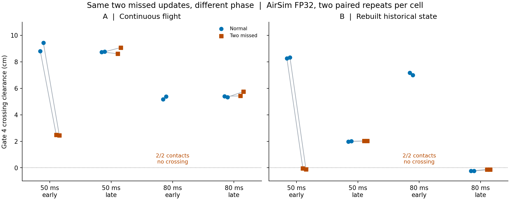

# 路线 B 论文研究发现与证据

更新至 2026-11-23。本文汇总实验中能够支持论文动机、算法设计或实验取舍的发现。**最合适的主线是状态决定哪条控制更新值得保护，时序瓶颈决定该怎么保护，共享资源上的成本归属决定其他回路会不会被牵连。** 具体机制的创新性仍需对照已有工作和统一闭环实验。

| 发现 | 现有证据 | 适合放在哪里 |
| --- | --- | --- |
| 同样漏两条，转弯早段与晚段的代价不同 | AirSim FP32，32 次飞行、16 对 | 论文动机，说明为何要保护具体更新 |
| 超期原因决定哪些动作值得试 | 板端成本驱动的合成回放，含反例 | A/B/C 启发式的设计依据 |
| 一次长尾会拖住共享资源，还会改变随后多个周期的选模 | 真板闭环诊断和固定日志复算 | 调度机制主线，连接 PS、DPU 与控制期限 |
| 单机通信异常可能被共用预算扩大为全组停更 | 真板受控故障对照与自然负载 | 成本归属和故障隔离的直接证据 |
| 局部推理更快时，端到端交付仍可能更差 | 同二进制四组真板探针试飞 | 端到端评价和系统基线 |
| 周期、模型深度、漏更次数各自都不足以刻画控制质量 | 教师对照、等时延 DNN 飞行、真板量化对照 | 明确实验边界和评价指标 |
| 跳更补更、设备分段、回收期限倒推各自有适用窗口 | 手算、合成回放、真板独立基准和负结果 | 限定当前主张，保留后续扩展 |

## 1. 同样漏两条，转弯早段的代价更大

这是目前最直观的控制层发现。原实验使用同一条路线、同一个 4×1024 FP32 DNN，在第 4 道门的**参考过门前约 0.94 s 和 0.15 s**分别干预。这里的早段和晚段是这条路线中的两个具体纠偏窗口。每个窗口内配对比较正常更新与人为跳过连续两条更新，跳过时仍保持上一条命令。两批分别从起点连续飞入和从历史状态重建，共 32 次飞行、16 个配对。

| 周期与试验范围 | 早段干预 | 晚段干预 |
| --- | --- | --- |
| 50 ms，从起点连续飞入 | 正常过门净空 **8.8–9.4 cm**，漏两条后 **2.4–2.5 cm** | 漏两条后的净空变化只有几毫米 |
| 80 ms，两批合计 | 漏两条后 **4/4 接触第 4 门左框**，相应正常组 0/4 接触 | 晚段组均无接触 |

实际空窗还取决于周期。相对目标释放，正常组约 18–21 ms 发出新命令，漏两条后在 50 ms 组约 118–121 ms、在 80 ms 组约 179–180 ms 才发出下一条。比较早晚时应固定周期，比较 50 和 80 ms 时应另报实际空窗。碰撞后未穿过门平面的试次没有过门净空值。越过门平面但身体净空为负的试次，应与实际接触门框分开计数。

一种有数据支持的解释是，早段正在建立纠偏动作。正常输出相对于旧命令的角速度变化，早段约 0.42–0.82 rad/s，晚段约 0.17–0.43 rad/s。因此值得研究的是**当前状态下保持旧命令的后果**，以及应该优先保护哪次更新。离门还剩多少秒、处于哪半段、漏了几条，可以作为观察量。用于调度前仍需验证它们能否预测代价。

**边界。** 这是同一路线、同一 FP32 模型的成对干预。两次主动漏更验证了后果，但自然拥堵是否会命中这些窗口、换到其他路线和板端 INT8 后是否重现、单次跳更和按期补更的损失，都要分别验证。弱硬实时研究已经分析过连发超期、旧输入保持与恢复，状态相关控制周期也已有形式化研究。这条实验证据适合支撑多 UAV 共享 DPU 场景中的关键更新识别，创新点要落在量化并利用这种差异。[早晚对照及复现](../../archive/controller_architecture_study/docs/Route-B组会材料_20261110.md) · [Vreman 等，ECRTS 2021](https://drops.dagstuhl.de/entities/document/10.4230/LIPIcs.ECRTS.2021.15) · [状态相关周期约束，RTAS 2025](https://profiles.wustl.edu/en/publications/integrated-real-time-control-and-scheduling-for-safety-critical-c)

**真板补测。** 在板端十二机路线的 Drone2 第 8 门，固定 20 ms 与板端 ID 11，单次漏更把确认空窗拉长至约 38～40 ms。四对通过预定的局部核对，净空变化最多 6.74 mm，八轮均通过该门。早段两对在离目标稍远的位置还有额外漏更。另一次自然拥堵中，Drone3 连续漏三条，空窗达 90.27 ms。所以下一轮单独测更长空窗的影响。当前这条证据提示，应把“在哪里漏”和“旧命令已经保持多久”一起考虑。[真板配对与连续漏更时序](Route-B关键控制更新闭环对照_20261123.md)

**怎样连回 $B(x,u)$。** 令 $B(x,u^{old})$ 是从观测时刻 $t_x$ 起，按现有模型估计旧命令还能保持的时长，则绝对保持期限是 $t_x+B(x,u^{old})$。下一条命令的生效期限再与任务槽期限和数据有效期限取最小。若相邻两次命令都生效，其实际间隔是 $T_k+R_{k+1}-R_k$。因此判断漏更后果，应跟踪旧命令版本和真实空窗，不能只看标称周期。现有保持量用于经验筛查，板端日志的命令确认仍是生效代理。[时间语义与保证边界](义务保护预算分配Framework_20261116.md)

## 2. 周期、响应时间和控制器能力会共同决定敏感区

- **周期与响应时间应独立控制。** 在 33 次单条件 AirSim 教师实验中，固定 $R\approx9$ ms 时，增益 3.5 的第 4 门净空在 $T=30,60,120$ ms 下为 **+6.7、+3.0、−0.3 cm**。增益 7 对应约 **+78.0、+77.7、+78.5 cm**。增益 10 在 $T=120$ ms、$R=99$ ms 的强压力点发生接触。这个矩阵使用 CPU MPC 教师和施加的命令延迟，每条件一次。它表明时序敏感性依赖于控制器和安全余量，不能从一条顺畅路线推断普遍规律。全程跟踪 RMSE 也可能掩盖关键门的净空恶化。[增益与时序实验](../../archive/controller_architecture_study/docs/Route-B组会材料_20261110.md)
- **更新频率的收益要与资源代价一起看。** 早期三机板端试飞中，固定 50 ms 与动态周期都完成了 15 道门，记录请求从 **1,199 降至 774**，实际生效的周期改动有七次。后测固定 80 ms 同样完成路线。因此这批支持功能可用和相对于固定 50 ms 的减负，强静态基线需要逐机离线优化后再配对。该结果适合说明应给 $T$ 保留负载管理作用，局部快速更新的物理收益要另测。[三机板端试验](../../archive/controller_architecture_study/docs/IP37联合控制首轮结果_20261107.md) · [固定 80 ms 与论文口径](../../archive/controller_architecture_study/docs/Route-B组会材料_20261110.md)
- **名义周期、命令确认和工作槽释放需要分别记录。** 早期六机对照中，ACK 后额外回读会延后同一 UAV 的工作槽归还。把回读延到下一次采样的两轮，前 10 秒均无时序违规，但整轮仍有违规。四种策略的 16 条目标更新均按期，所以这批不能证明重排或延期回读救回了关键更新。若关键更新压根没进入 DPU 队列，设备排序本身无法补救。[六机准入审计](../../archive/controller_architecture_study/docs/Route-B关键任务准入_20261109.md)

## 3. 按原因选动作，比一味换模型或提高频率更有解释力

A/B/C 的研究价值在于**先排除来不及的动作**。A 检查即使立即获得设备、执行最快合格模型，是否仍会超期。B 检查给定窗口的必要计算量是否已超过可用容量。C 则在实际存在可行顺序的证据下，判断重排、阻塞或恢复顺序是否能修复。A、B 的必要条件可剪枝，容量充足只表示尚未被排除。合成场景层的名字来自生成规则，运行诊断仍按真正的状态与期限计算。

| 160 个场景中原配置失败的层 | 只调周期 | 只换模型 | 只改派发顺序 | 允许周期与模型联合改动 |
| --- | ---: | ---: | ---: | ---: |
| A，32 例 | 28 | 0 | 0 | 28 |
| B，40 例 | 0 | 32 | 0 | 32 |
| C，35 例 | 1 | 34 | 23 | 34 |
| 混合，40 例 | 0 | 0 | 0 | 37 |

这里的修复指整组时序约束可满足。有限枚举在 147 个原配置失败样本中找到了 131 个可修复样本。总检查预算为五次，第一遍查原配置。固定顺序修复 28 例，无诊断局部搜索 69 例，带派发保护的 A/B/C 修复 131 例；再算入 3 ms 入口决策预算，最后结果为 130/131。C 层也能通过换模型缩短阻塞，但调序可减少不必要的降档。更重的十二回路回放里，计入实测决策耗时后，整任务 A/B/C 为 23/160、仅换模型为 40/160。真实第 4 门附近 59 个历史快照的有限枚举没有找到可行方案，其中 33 个在决策时已有首个任务义务到期。因此论文对照必须同时限制检查次数、计入墙钟耗时，并衡量建议能否赶在任务边界前生效。[动作回放](../../archive/controller_architecture_study/docs/Route-B动作回放_20261109.md) · [重负载回放与组会图表](../../archive/controller_architecture_study/docs/Route-B组会材料_20261110.md)

## 4. DNN 的推理价格可测，闭环价值需单独验证

- 两个旧 INT8 模型均已常驻时，4×1024 与 33×1024 的交替服务 P99 为 **1.334 ms、11.787 ms**。在该负载下，交替相对于连续运行的匹配服务差的 P99 约 11 μs。前者是计算档位成本差，后者是特定板端条件下的额外变化，两个数字不宜混合使用。[真板双模型对照](../../archive/controller_architecture_study/docs/Route-B板端配对实验_20261106.md) · [组会汇总](../../archive/controller_architecture_study/docs/Route-B组会材料_20261110.md)
- 四个 FP32 模型以相同 50 ms 周期和 20 ms 目标延迟飞三类完整路线，12 次均有效过门。两条较难路线的最小过门净空约 29 cm，模型间只差约 5 mm。终点制动的恢复标准均未通过。该对照支持“这些路线的过门表现差别较小”，更急的局部初态也尚未给出稳定的只有大模型合格的例子。[等时延飞行结果](../../archive/controller_architecture_study/docs/Route-B组会材料_20261110.md)
- 同一 480 条历史工程样本对照中，FP32 与 INT8 误差排名的 Spearman 从旧版 **−0.247** 变为重量化版 **+0.763**。这是板端对教师拟合的结果。新包在静止起飞仍出现过 RAW237 量程拒绝，具备等时延闭环资格的范围需要另测。研究应分别记录模型服务成本、量化可用性、教师误差、闭环损失。架构深度仅标识模型。[Release001 板端验收](../../archive/controller_architecture_study/docs/最终报告与Windows交接_20261115.md) · [新包静止起飞对照](Route-B的Release001实测_20261116.md)

## 5. 一次长尾有两种跨回路传播路径

### 单机通信异常经共用预留扩大

十二机 20 ms 正式飞行中，两次失败轮的命令预留升至 **42.606 ms、35.104 ms**，主要在 ping 返回段。把一次观测写入所有回路共用的预留，一旦高于 20 ms，后续任务连留给 DPU 的正预算都没有。两轮各出现约 95 次相应派发拒绝，最终整组到期退出。

真板受控对照只推迟 Drone3 的一次 ACK 处理，模拟看到约 42.7 ms 的迟到样本。关闭隔离时，其他机在异常后按时交付的新任务为 0，十二架退役。开启逐机命令成本后，其他机共交付 **10,338 条**新任务，十架持续到测量结束。Drone3 按原期限退出，Drone4 后来因独立的锁等待和共享模型成本上升而退出。随后无注入的一轮自然负载中，Drone8、Drone9 各经历约 18 ms 的 ACK 尖峰，其他十架在第二次异常后交付 **3,439 条**新任务并持续至窗口末。自然对照各一轮且尖峰强度不同，能看到局部隔离，整体净收益需再测。[实验九至十一及原始数据入口](Route-B分段DNN与保持期限_20261122.md)

### PS 等 CPU 经共享模型成本影响后续选模

同步 DNNDK 调用中，执行线程返回并释放日历占位前，调度器还不能派发下一条 DPU 任务。真板诊断匹配 **18,131 次**推理。最慢的一次调用耗时 **9.319 ms**，其中至少 **7.920 ms** 是线程就绪后等 CPU。本轮四个超过 3 ms 的样本均以同类等待为主。这证明了该轮一些表面上的 DPU 长尾主要发生在 PS 调度环节。其它没有线程计数的历史尖峰仍需分别定位。

等待也可能发生在提交推理之前。在更早的一轮，某次模型 5 被记入 **10.907 ms** 服务时间，其中 **10.750 ms** 发生在日历派发时间戳到执行器记录出队之间；DNNDK 提交到结果可读仅 **108 μs**。同轮 694 次因模型放不下而拒绝的任务中，若仅在固定日志里采用初始最快档成本，有 664 次可过这道局部检查。这是成本归因的反事实。实际放行会改变队列负载和控制状态。[派发分段计时与拒绝复算](Route-B分段DNN与保持期限_20261122.md)

更有论文价值的是后续影响。固定该轮的任务、实际派发时间、模型池和每机下发预留复算，最慢样本使模型 11 的经验成本从 **4.554 ms** 升到 **9.465 ms**。此后 2,766 条能核对预留的派发中，其他十架机的 **131 条**任务预算落在这两个值之间。实际运行中这些行使用模型 8 或 5。**131 衡量的是模型 11 的时间资格被收窄的次数**，实际会不会选它、几何安全是否改善，仍依赖其它义务、资格及状态。

一次从 $p_c^-$ 到 $p_c^+$ 的更新可用以下量描述。$b_j$ 是固定历史条件下任务 $j$ 的剩余设备预算。

$$
N_c = \#\{j: p_c^-\le b_j<p_c^+\}.
$$

论文应另外统计其中多少个任务失去了**全部**合格档位，以及是否恰逢关键纠偏窗口。前者才直接走向时序不合格，后者才把时序损失接回控制损失。尝试拆分计算时间、PS 等待与逐机通信时，仍要计入设备确实不能重新派发的时间。已有 GPU 研究处理完成通知、工作线程优先级继承和预算影响；本工作的潜在差异是测量并限制长尾通过共享 DNN 成本传播到多个状态相关的控制期限。[实验十一、十二及 131 条复算](Route-B分段DNN与保持期限_20261122.md) · [GPUSync](https://www.cs.unc.edu/~anderson/papers/rtss13c.pdf) · [GCAPS](https://drops.dagstuhl.de/entities/document/10.4230/LIPIcs.ECRTS.2024.14)

## 6. 局部加速可以把压力留给端到端链路的其他阶段

同一四轮十二机试飞里，默认 DNNDK 调用 P99 为 **1.810 ms**，仅绑核和绑核叠加提高调度权重分别约 **1.333 ms、1.335 ms**。组合轮的发布到入队 P99 却从默认的 **5.795 ms** 增至 **7.543 ms**。首个退役之前 1,923 条严格匹配的计划发布里，默认、仅绑核、仅提高调度权重、组合的按时交付分别为 **1,824、1,922、1,827、1,483**。组合轮共 1,049 条下发前丢弃，其中 957 条进入最终检查时跨过了预算门槛。共同窗口内，该组开始检查时的余量中位数为 0.752 ms，默认组为 1.302 ms。最终取锁 P99 没有同方向恶化，单独改善一个阶段不足以保证控制结果。

四种配置各一次自然负载。仅提高推理线程调度权重的一轮完成全部 144 道门。四轮严格时序均未通过。对论文有价值的验证是交错重复，并同时量化发布、准备、DPU 排队、完成后下发、每机自由余量和物理结果。绑核和静态优先级是强基线。[四轮实板结果、共同窗口及入口余量](Route-B分段DNN与保持期限_20261122.md)

## 7. 方案必须赶得及提交，跳更和分段都要核算净收益

| 机制 | 已知结果 | 论文使用边界 |
| --- | --- | --- |
| 规划状态及时可用 | 一轮十二机 4,466 次管理规划中，只有 8 次同时满足全组匹配状态且无在途命令的必要条件，联合计划安装为 0。 | 不能把“上下文未就绪”解释成“物理上无可行方案”。应量化匹配状态到达、规划用时、发布锁定及实际提交。[板端交接与规划审计](Route-B实现现状与交接_20261117.md) |
| 保持期限归属 | Drone10 的旧命令到期日志回放中，到期后 0.511 ms 可检出，比位置保护早约 3.09 s；回放可少发布 152 次反复被同一过期期限拒绝的任务。后续真板试验又验证了按机发生真实退役。 | 旧控制版本与期限必须绑定。重新采到状态和新的控制实际已生效是两类事件。逻辑退役、备用悬停或制动、物理恢复要分别验收。[到期回放](PS命令保持期限回放与重构记录_20261118.md) · [后续板端数据](Route-B分段DNN与保持期限_20261122.md) |
| 跳过一次并限时补更 | 480 个合成场景，A/B/C 无跳过通过 325，加入相位与补更仅增到 326。将决策预留改为 8 ms 并锁定已发布任务后为 29，两个因素一起改变。 | 主动跳过的附加收益在这批很小。60,000 次自检验证固定已知序列的前推与倒推一致。一次主动跳过的实际损失、硬保持资格和按期补更仍应验收。[相位方案回放](../../archive/controller_architecture_study/docs/Route-B相位感知Framework_20261114.md) · [论文草稿中的数值自检](Route-B论文草稿_20261115.md) |
| 选择性 DNN 切段 | ID 11 真板独立基准中，整网与两段 INT8 输出在 960 组上逐项相同，额外耗时中位数 21.33 μs。受控双任务有切段帮助的例子。三轮十二机日志 32,624 次 ID 11 起跑中，局部回放没找到只能靠切段修复的任务对。 | 先证明切口前有可预测的急任务，并扣除额外 PS 返回、张量交接和继续执行。段边界可让出和正在执行的 kernel 内抢占是两种能力。有已有 RICH 等分段调度先例。[分段实验](Route-B分段DNN与保持期限_20261122.md) · [RICH，DATE 2025](https://doi.org/10.23919/DATE64628.2025.10993261) |
| 从队尾倒推当前最迟回收时间 | 已就绪队尾的 15,142 个可筛查起跑里，339 次队尾会收紧正可行期限，未观察到实际返回满足本任务期限却越过该队尾期限的样本。 | 可以保留公式作为较重负载的备选检查。现有观测更直接支持共享成本传播这一方向。[实验十二的回收期限筛查](Route-B分段DNN与保持期限_20261122.md) |

## 8. 建议把哪一条写成论文主线

1. **动机**。用第 4 门配对图说明，每次控制更新的价值随状态和旧命令而变。再用真实板端长尾说明，某条关键更新的时序还会受到别的回路和共享成本规则影响。这两条当前已有独立实验证据。
2. **拟验证贡献**。用可解释的时序判据区分发布过晚、计算窗口不足、执行顺序与 PS/通信等待。对每类候选动作说明它减少哪一段开销、影响哪些任务，以及怎样用全组绝对期限受控提交。沿用真实设备不可重新派发的时间和各机有效控制期限。线性小模型、一次跳更和分段只在能够测到额外作用的条件下纳入。
3. **决定论文能否成立的闭环结果**。预先冻结若干独立路线与负载，找出经过单次漏更配对的关键更新。在相同模型池、资源和时序预算下，比较逐机离线优化的静态配置、同候选预算的无诊断规则、带原因剪枝和成本归属的策略。分别报告关键更新交付、其它回路损失、碰撞、最小净空、模型实际切换和决策耗时。若只改善日志预算或单段 P99，应把结论收敛到系统现象与调度测量。FALCON 已有 FPGA 控制器复杂度、硬件与资源配置联合设计，状态相关周期与完成处理优先级亦有先例；路线 B 的差异要用这条闭环证据链体现。[FALCON](https://xplorestaging.ieee.org/document/11315118) · [路线 B 论文草稿](Route-B论文草稿_20261115.md) · [修订 Framework](义务保护预算分配Framework_20261116.md)
