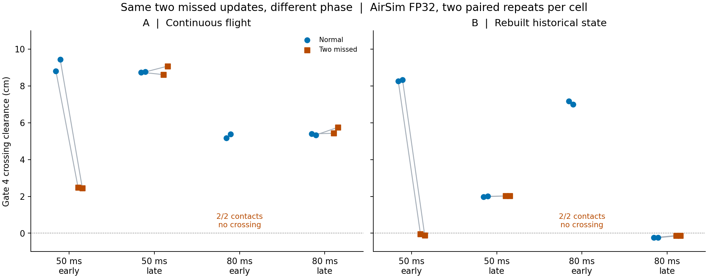

# 面向多无人机神经控制的实时调度：用限时补更管理共享 DPU

**中文论文初稿 · 路线 B · 2026-11-15**  
本文给出研究动机、调度算法、有限窗口判据及验证方案。新增方法属于待验证的设计。已有飞行结果、合成回放和手算示例均注明来源。

2026-11-16 已收到新18档真实板端验收，并实现有限日历调度核心。新实现采用保留更新优先、有限修复和补更检查，给下一条派发任务倒推升级预算。本文后面的旧回放数字保留原实验口径，当前代码和新成本回放见[release001 实现与结果](Route-B的Release001实现_20261116.md)。

## 摘要

多架无人机共享一个神经网络推理加速器时，一次不可抢占的推理可能阻塞另一架飞机即将发布的控制更新。控制任务的紧迫程度还会随飞行状态改变。已有 AirSim 配对观察表明，在同一条路线和同一控制器下，连续漏掉两次更新在转弯早期可造成明显的净空损失甚至碰撞，晚期干预的后果较轻。本文据此提出一种调度方法，把允许短时沿用旧控制的时段转化为**带补更期限的临时减载**。调度器分别为“按原计划更新”和“跳一次并限时补更”计算可行时间预算，据此决定当前任务可用的模型档位。算法以端到端期限和全组检查约束改动，并在固定设备顺序下给出精确的时序判据。现有证据支持研究动机和该判据的适用条件。完整调度在新 INT8 模型上的闭环收益留待板端验证。

## 1. 引言

一架无人机过门时，需要反复读取状态、计算控制命令，再把命令施加到飞机。本文所用的神经网络控制器学习了一个模型预测控制器（MPC）的输出。MPC 根据当前状态和未来参考路线计算推力与角速度。部署时，DNN 用 237 维输入快速近似这一步。CPU 仍负责采样、准备输入和下发，FPGA 上的 DPU 负责推理。多架飞机的 CPU 工作可以与 DPU 推理重叠，但这里共享的一个 DPU 一次只能跑一个完整模型，启动后不能在中途切给另一架飞机。

这会出现一个具体冲突。一架正在平稳飞行的飞机已经准备好输入，此时启动一个耗时较长的高精度模型，可能堵住另一架正要建立转弯纠偏的飞机。后者的输入还在 CPU 上准备，当前的 DPU 队列里甚至看不到它。全程平均延迟、平均轨迹误差或总体 DPU 利用率，都可能掩盖这次局部失效。

本项目有三条观察，由此把研究问题收敛到**如何安排下一次必需的控制生效**。

| 项目观察 | 对设计的影响 |
| --- | --- |
| 在部分正常路线和教师配置中，短周期与长周期的过门差异较小 | 只有窗口确实缺少及时更新或计算资源时才动周期。可以提前一次尚未发布的任务，也可以放宽低风险回路未来的周期 |
| 同样连续漏两条，在一条路线的早弯和晚弯后果不同 | 需要判断旧命令能否继续保持，以及下一条命令最晚何时必须生效 |
| 不同 DNN 的设备耗时差异明显，精度和闭环能力则随模型、量化和状态变化 | 先用闭环证据筛出合格模型，再按共享设备能提供的时间选档 |

这些观察引出一个可检验的问题。**能否把某架飞机现在可以让出的计算时间，转换成一份有明确还期的补更义务，并用这份义务决定其他飞机现在还能跑多长的模型？** 论文的研究对象是这个跨回路的决策。模型训练和重量化为它提供有实际成本差异的可选档位。[现有飞行和调度证据](../../archive/controller_architecture_study/docs/Route-B组会材料_20261110.md) · [模型池与实测成本](../../archive/controller_architecture_study/docs/Route-B的Main18预算选模_20261111.md)

## 2. 方法概览

系统先根据各机状态生成必须满足的控制期限，再用近期任务的顺序估算共享 DPU 还有多少可用时间。普通情况下，直接在合格模型里选一个能装入当前预算的档位。若保留当前日历时无解，就根据瓶颈选择修复动作。支持临时跳过时，同时检查当前受益和后续补更。通过全组检查且日历版本仍然有效才提交。

~~~mermaid
flowchart TD
    X["状态、路线进度、正在作用的命令"] --> A["生成命令生效期限和合格模型集合"]
    A --> B["登记下一次更新与已经承诺的补更"]
    B --> C["倒推本次最大连续占用时间"]
    C --> D{"原计划有可行派发？"}
    D -->|"有"| E["查合格模型，派发或等待就绪"]
    D -->|"没有"| F["按发布、容量或阻塞诊断修复"]
    F --> G["若考虑跳过，同时生成限时补更计划"]
    G --> H["检查全组期限、工作槽和日历版本"]
    H -->|"通过"| B
    H -->|"失败"| J["报告未满足义务，进入已配置的应急分支"]
    E --> X
~~~

**图 1 · 调度器的工作流程。** 物理状态用于确定哪些更新要保护。设备上的执行时长由所有已登记的控制义务共同限制。

### 2.1 将飞行状态转成绝对期限

对任务 $j$，$r_j$ 是计划发布时刻，$a_j$ 是命令实际生效时刻。总响应时间 $R_j=a_j-r_j$ 包含采样、前处理、等待、推理和下发。设 $d_j^{\rm slot}$ 是任务在日历上的完成界限，固定周期时通常为 $r_j+T_i$。旧控制最迟只能保持到 $d_j^{\rm hold}$，新结果的采样数据最迟在 $d_j^{\rm fresh}$ 前可用。因此

$$
d_j^{\rm act}=\min\{d_j^{\rm slot},d_j^{\rm hold},d_j^{\rm fresh}\},
\qquad a_j\le d_j^{\rm act}.
$$

保持期限从**状态观测与实际在作用的旧命令**一起计算。若以 $t_x$ 的观测估得还能保持 $B_i(x_i,u_i)$，则 $d_j^{\rm hold}=t_x+B_i(x_i,u_i)$。决策和通信已经用掉的时间自然反映在绝对时刻里。日历改期或主动跳过后，旧控制的保持期限继续有效。原型可以用回放估计这个预算。要作物理安全声明，需要另行验证动力学、保持界、观测误差与执行时序；本文将其作为调度接口的输入。

### 2.2 从早弯漏更观察到一条可执行规则

一次跳过会让飞机继续使用旧命令。最重要的问题是**这一整段时间里，旧命令是否仍适用于即将经过的状态**。飞行相位是线索，还需检查横向余量、运动趋势、参考转向及实际控制。离线在同初态下分别试验正常更新、保持旧控制和补更，得到按路线阶段及状态分组的资格。数据不足、即将跨入敏感区或上一条已经被跳过时，保留当前更新。

对于有资格暂缓的任务 $j$，调度器只允许撤回仍可编辑的槽。把下一条原定更新转为强制补更 $j^+$，若已有槽则强化其期限，避免重复计入一个任务。补更的生效期限取其正常期限与旧控制保持期限的较早者。

$$
d_{j^+}^{\rm recover}=\min\{d_{j^+}^{\rm act},d_j^{\rm hold}\}.
$$

例如旧命令只可保持到 110 ms。若跳过 50 ms 发布槽后，100 ms 发布的补更预计 120 ms 才真正生效，这次跳过就无法通过。它可能减轻了当前 DPU 的工作，却把风险推到了之后的窗口。**补更计划与跳过一同提交，并一直保留到有效命令生效。**

### 2.3 反推当前可以占用的 DPU 时间

将设备端的任务写成三个量。$q_j$ 是输入最晚就绪的预算，$p_j$ 是一个闭环合格保底模型的设备耗时上界，$d_j$ 是从命令生效期限扣除下发链路上界得到的 DPU 完成期限。补更任务用上节的补更生效期限做同样换算。模型资格与命令作用时延相关，需覆盖本次计划允许的整个时延区间。不同模型的切换和交接开销计入相应预算。

给定当前准备先派发的任务 $i$，把它从保留的后续队列取出。设余下顺序为 $j_1,\ldots,j_n$。从最后一条义务倒推

$$
\ell_{n+1}=+\infty,\qquad
\ell_k=\min(d_{j_k},\ell_{k+1})-p_{j_k}.
$$

$\ell_k$ 表示 $j_k$ 必须在什么时候开始推理，才能按这条顺序交完后面的所有命令。若任何 $q_{j_k}>\ell_k$，这条后续队列本身就无法兑现。否则，在时刻 $t$ 先执行已就绪的 $i$，本次最大连续占用时间为

$$
b_i(t)=\min\{d_i,\ell_1\}-t.
$$

用 $b_i$ 查候选成本表。设 $\mathcal A_i$ 为经过当前状态和延时资格检查的模型集合，$E_i(c)$ 为该档的质量排序指标，则

$$
c_i^*=\arg\min_{c\in\mathcal A_i,\ C_i(c)\le b_i(t)} E_i(c).
$$

模型误差可以由同样本教师拟合误差近似，用作合格档之间的排序。闭环净空、跟踪和恢复资格由独立试验衡量。若所有合格模型都装不进去，就检查其他 ready 任务，或在已验证顺序允许时等即将就绪的受保护任务。

**固定顺序判据。** 给定确定的释放时间、截止时间和执行时长，按该尾序列，前一个任务结束与当前任务就绪两者的较晚时刻是当前任务的最早开始时间。逐项前推，与从末尾逐项倒推的条件等价。因而，当 $q_{j_k}\le\ell_k$ 对所有尾任务成立，当前任务结束不晚于 $\ell_1$ 且满足自身期限时，整条给定序列按期。这个检查对一条尾序列为线性时间。它检验的是给定顺序和确定输入下的设备时间约束。对于保守上界则给出相应前提下的充分性，PS 工作槽和实际控制命令的有效性仍需检查。

### 2.4 新的调度动作是比较两份完整日历

对每个确实可撤回的候选更新 $j$，比较两份短窗口计划。第一份保留已有更新，第二份撤回 $j$ 并登记其补更 $j^+$。分别计算当前任务的设备预算 $b_i^{\rm keep}$ 与 $b_i^{\rm skip+recover}$。当两份计划的尾序列都可行且当前可用时间非负时，将实际可用时间的变化量写为

$$
\Delta b_{i\leftarrow j}=b_i^{\rm skip+recover}-b_i^{\rm keep}.
$$

该量度回答**让出计算的一架飞机，考虑它以后还要补更，净结果到底能给另一架飞机增加多少连续推理时间**。若替代计划因补更无解，直接拒绝。两份计划的尾序列可行、且最快合格模型落在新增的预算内时，一个原先过不去的任务就可在模型中被修复。如果两种方案都已满足全部必要更新，默认保留原日历。若原计划本身无可行尾序列，则直接比较修复后的全组可行性，不对无效时间做差。计划只在已有合格闭环模式范围内修改；补更义务本身可以在后续调度中限制另一个回路的模型。

### 2.5 A／B／C 在什么时候介入

| 诊断 | 含义 | 尝试的修复 |
| --- | --- | --- |
| A · 单条控制链来不及 | 当前发布和模型下，即使独占资源也无法在期限前交付 | 提前尚未发布的更新，或换更快的合格模型。立即开始也来不及时，记录反应余量不足 |
| B · 某个短窗口容量不足 | 窗口内必须执行的 CPU 或 DPU 工作下界大于可用供给 | 换轻模型、推迟已验证可放宽的未来发布，或尝试带补更的临时减载 |
| C · 当前顺序和阻塞造成迟到 | A、B 未判定无解，实际前推仍有任务被阻塞 | 检查阻塞来源，调整尚未开始的任务顺序或为即将就绪的任务留空 |

快速派发只使用有限候选和现有已检查顺序。较贵的 A／B／C 联合检查在期限收紧、输入进度变化或计划无法兑现时运行。诊断用乐观下界来排除不可能的动作，批准则应使用适用的上界和全组时序。提交前核对未发布任务是否仍可改动、当前模型是否已开始、数据是否新鲜及补更是否仍在日历内。没有可提交的方案时报告哪条义务失效。实际应急策略及其闭环资格在部署阶段单独验证。

## 3. 用三个任务看清这个机制

假设现在是 0 ms。A 的输入已准备好，自身设备期限为 10 ms。A 有 **3.2 ms 和 5 ms** 两档合格模型。B 将进入紧张的转弯阶段。C 处于经过验证可以短暂保持旧控制的阶段。

| 保留的设备任务 | 就绪时间 | 设备期限 | 执行时长 |
| --- | ---: | ---: | ---: |
| B，必需的关键更新 | 2.5 ms | 5.5 ms | 2 ms |
| C，保留当前更新时 | 4 ms | 7 ms | 2 ms |
| C 的下一次更新，若当前槽跳过则必须兑现的补更 | 7 ms | 8.5 ms | 1 ms |

为保持比较公平，7 ms 的下一次更新在两份日历中都保留。保留当前 C 时，倒推得 C 最迟 5 ms 开始，B 最迟 3 ms 开始，所以 A 无法先启动 3.2 ms 档。此时仅重排也无解。B 和 C 必须先于 A，A 插在 C 的两次更新之间会拖过 8.5 ms 的期限，排在最后则会错过自身的 10 ms 期限。若 C 通过保持资格检查，则撤回当前 C 槽，把下一条强化为必须兑现的补更。本例设备侧补更期限仍是 8.5 ms，B 改为最迟 3.5 ms 开始，A 便可用 3.2 ms 档先执行。

~~~text
保留 C，先启动 3.2 ms 的 A
0 ── A ── 3.2 ── B ── 5.2 ── C ── 7.2    C 当前槽晚 0.2 ms

C 跳一次并锁定补更，再启动同一档 A
0 ── A ── 3.2 ── B ── 5.2 ── 空等 ── 7.0 ── C 补更 ── 8.0
~~~

这次让出的有效预算只有 **0.5 ms**，虽然取消的 C 本来要占用 2 ms。B 自身的期限仍在约束前面的 A。如果补更的设备期限收紧到 **7.5 ms**，它自己都无法在 7 ms 就绪后运行满 1 ms，撤回方案就应被拒绝。如果 A 另有一个闭环合格的 2 ms 档，原日历下可以先跑该档，首版策略应保留 C 的更新。以上均为手算输入，用于解释调度机制。

## 4. 已有结果与待验证实验

### 4.1 已有飞行证据

在同一条 AirSim 路线上，使用相同的 FP32 模型，研究曾主动漏掉连续两条更新。50 ms 周期的连续飞行配对中，早弯正常净空约 8.8–9.4 cm，漏更后为 2.4–2.5 cm。晚弯净空变化为毫米级。80 ms 周期下，早期干预的四次飞行均接触左门框，晚期干预没有接触。该现象提供了按当前控制所处阶段保护更新的动机。跨路线的一次跳过与限时补更效果属于待测问题。

**图 2 · 同样的漏更次数在同一路线的不同阶段有不同后果。** 蓝点为正常，橙点为漏更。接触门框且未穿过门平面时无过门净空点。右侧为历史状态重建，左侧为从起点连续飞入。[完整实验背景](../../archive/controller_architecture_study/docs/Route-B组会材料_20261110.md)

### 4.2 已有模型和调度证据

- 18 档旧 INT8 搭配旧板端已有实测。Ubuntu 新 PTQ 摘要来自参与候选选择的 512 条样本，公开了六档绝对误差。以这六档误差和旧板端时延组成的假定池，点估计的成本与误差前沿为 2×128、3×256、4×1024。量化候选的独立样本误差、新板端成本和控制能力均需另测。[旧版实测](../../archive/controller_architecture_study/docs/Route-B的Main18预算选模_20261111.md) · [重量化验收](../../archive/controller_architecture_study/docs/Ubuntu-Main18重量化交接_20261111.md)
- 在之前的 480 个四机／八机合成场景中，固定配置 55 个通过联合检查，A／B／C 无跳过为 325 个，加入相位与补更检查为 326 个。用 8 ms 决策预留并锁住此前已发布的任务后，后者为 29 个。它说明有必要提前决策，也表明主动跳过的额外通过数在该负载里很小。该实验对应旧回放策略。[原始回放](../../archive/controller_architecture_study/docs/Route-B相位感知Framework_20261114.md)
- 本稿对“保留当前槽”和“撤回当前槽并强化下一槽”两类固定序列进行数值自检，共核对 60,000 次前推与倒推判断，结论逐项一致。第 3 节的完整两份日历也已逐项验算。这些自检覆盖给定时序输入下的代数判断。完整在线策略的决策耗时和收益尚无测量。

### 4.3 正式实验设计

| 研究问题 | 对照 | 主要指标 | 进度 |
| --- | --- | --- | --- |
| 现有相位与保持信息能否预测一次跳过的后果 | 同一初态和模型，正常更新、跳一次、跳一次后在不同时间补更。覆盖独立路线的早／晚弯和不同初始横向速度 | 碰撞、最小净空、瞬态误差、恢复时间，按路线配对 | 待实测 |
| 完整补更约束能否改变有效决策 | 相同模型池、相同前瞻窗口、相同跳过资格和同样的重排预算。对照只检查最近的关键任务、检查完整未来义务的方案，以及禁用跳过 | 关键更新迟到、补更超期、每机最小时间余量、主动跳过与意外漏更分别计数 | 待实现新派发策略的整队列回放 |
| 系统是否在相同资源上获得更好的闭环质量 | 离线选优静态基线、前瞻 EDF 加同样的换模能力、完整方案。使用同路线、初态和资源的配对试验，从有可行恢复能力的转弯开始 | 全程跟踪代价、局部净空与碰撞、设备空等、模型占用分布、CPU 决策延迟及其尾部 | 待上板 |

调度阶段可先用旧板 P99 和新 PTQ 摘要模拟 DPU，并用小规模有限枚举记录错过了多少本可行的方案。模拟应报告 CPU 预留敏感度，P99 计时按统计证据解释。上板后冻结新模型与实测成本，重复相同策略，使用实际生效时间核对命令交付。若相位资格在独立路线中失效，或者加入补更以后几乎没有可用的新增设备时间，就应收窄技术主张。

## 5. 与相关工作的关系

RICH 的 MRAF 从异构控制链的结构中抽取“剩余加速段数”作为运行时排序依据。它给本课题的启发是从工作负载找一个能解释调度决策的量。当前每条控制推理通常只占用一个不可抢占的 DPU 段，本文选用的量是**考虑本次更新和后继补更之后，其他飞机还能获得多少连续设备时间**。FALCON 为本工程提供 FPGA 神经控制和配置优化背景。[RICH](https://doi.org/10.23919/DATE64628.2025.10993261) · [FALCON](https://ieeexplore.ieee.org/document/11315118)

非抢占近似计算已经研究过通过运行时选择精度来回收任务间余量。TimelyNet 用动态期限选网络。DMAC 讨论了漏期和跳过处理，控制与调度的联合研究也已有从控制延迟界推导调度要求的方法。因此论文应回答一个更具体的问题：**同一个可撤回的控制更新，在计入由它产生的强制补更之后，能否给另一条闭环创造可用的推理时间？** 将两份日历对照、状态资格与多任务倒推接起来，是本文提出的机制。当前检索用于建立对照，独立新颖性与系统收益需由更全面的文献检查和实验支撑。[非抢占近似计算](https://www.ece.umn.edu/~sachin/conf/dac18.pdf) · [TimelyNet](https://tanrui.github.io/pub/TimelyNet-EMSOFT.pdf) · [DMAC](https://drops.dagstuhl.de/entities/document/10.4230/LIPIcs.ECRTS.2019.1) · [控制与调度联合设计](https://www.sudvarg.com/publications/RTAS2025_Integrated_Control_and_Scheduling.pdf)

## 6. 结论

本文提出把有限的控制更新容忍度转化为可调度的补更义务，并按保留与替代日历各自允许的连续 DPU 占用时间决定派发。路线内的相位观察支撑了这一研究动机，固定顺序的时序判据给出了算法成立的计算条件。真正需要上板检验的是这份补更义务能否及时兑现，以及收益是否能在独立路线和强基线下转化为更少的关键更新迟到与更好的闭环结果。
